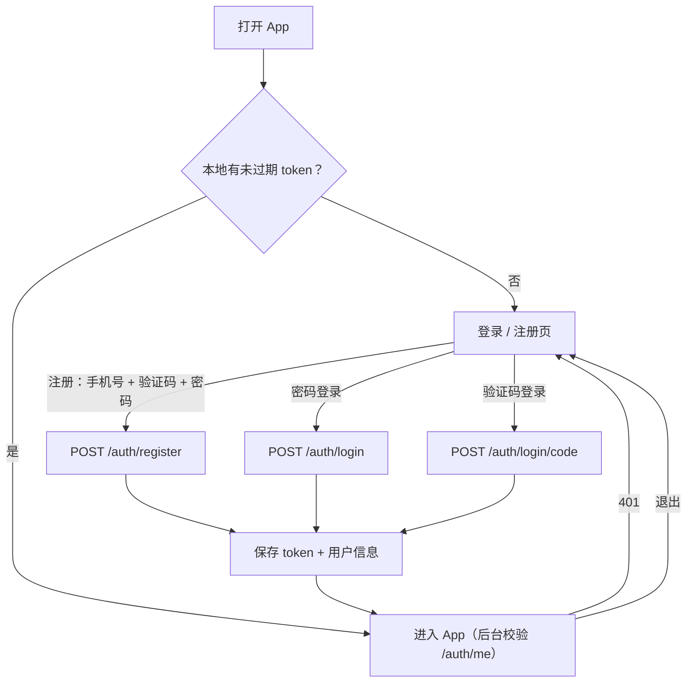
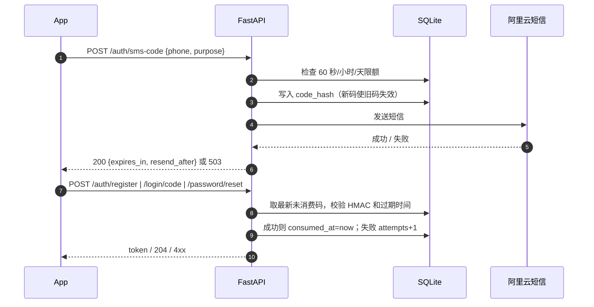
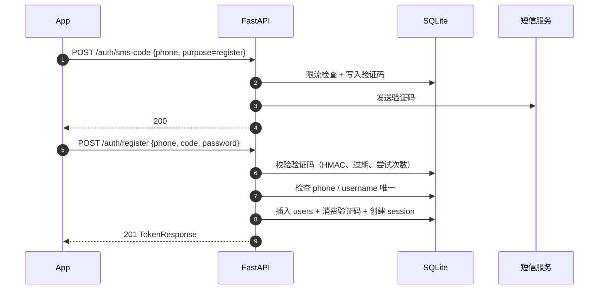
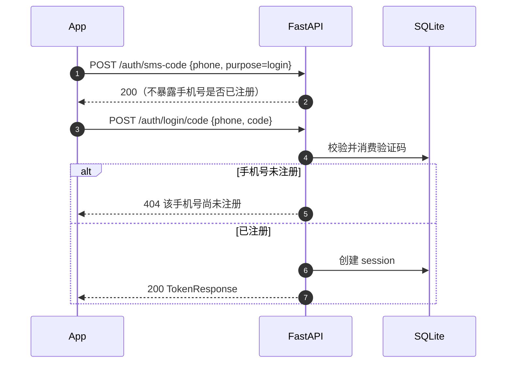

# 手机号注册登录与 App 登录门禁方案

> - **状态**：设计稿 v1（待评审）
> - **日期**：2026-11-08
> - **范围**：服务端账号/短信验证码/改密接口，Android 登录、注册、改密、退出与登录门禁。
> - **不包含**：代码实现、真实短信通道开通、云端历史同步、账号注销与完整的隐私合规页面。
> - **现状基线**：`server` 0.5.0 + `main`。服务端已有用户名/密码账号、Bearer 会话和任务归属；
>   Android App 仍匿名调用分析接口，没有登录界面、token 存储和登录门禁。
>   相关现状见 [server-persistence-accounts.md](../server-persistence-accounts.md) 与
>   [app-interaction-flow.md](app-interaction-flow.md)。

## 1. 背景与问题

### 1.1 现在有什么

| 层 | 现状 | 代码位置 |
| --- | --- | --- |
| 服务端账号 | `users` 表存 `username`、`password_hash`；scrypt 哈希；`sessions` 存 token 的 SHA-256 摘要，默认 30 天过期 | `server/app/services/accounts.py`、`db.py` |
| 服务端接口 | `POST /auth/register`、`POST /auth/login`、`GET /auth/me`、`POST /auth/logout` | `server/app/api/auth.py` |
| 鉴权开关 | `BASKETBALL_REQUIRE_AUTH` 默认 `false`；分析接口可匿名调用，登录用户的任务与账号绑定 | `server/app/config.py`、`api/routes.py` |
| App 网络 | `AnalysisApi` 用 OkHttp 直连，不带 `Authorization`；没有登录相关 DTO 和接口 | `android/.../data/AnalysisApi.kt` |
| App 页面 | 单 Activity + Navigation Compose，启动直接进首页；没有登录门禁 | `ui/BasketballApp.kt`、`MainActivity.kt` |
| App 历史 | Room `analysis_records`（version 2）只存在本机，不区分账号 | `data/local/AppDatabase.kt` |
| 片段播放 | 结果页把服务端片段 URL 交给 ExoPlayer 直接播放；`VideoPlayer` 已支持 headers，但调用方未传鉴权头 | `ui/clip/ClipPlayerScreen.kt`、`ui/common/Components.kt` |

### 1.2 要解决的问题

1. **注册必须验证手机号**，手机号是真人可达、可用于找回账号的凭据。
2. **两种登录方式**：账号 + 密码；手机号 + 短信验证码。
3. **支持修改密码**；忘记密码时也要有可走通的恢复路径。
4. **App 的所有功能登录后才能使用**，未登录只能看到登录/注册页。
5. 不能推倒现有服务端账号体系；已有用户名账号仍然可以登录。

### 1.3 与现有设计的关系

- [app-interaction-flow.md](app-interaction-flow.md) 的设计原则里写了「不强制登录，减少首次使用摩擦」。
  本方案按新需求把它改为**登录门禁**：首次启动先登录/注册，进入 App 后的录制、上传、结果、历史流程不变。
- [server-persistence-accounts.md](../server-persistence-accounts.md) 的服务端账号/token 设计继续沿用；
  本文在它之上增加手机号、短信验证码、改密和 App 接入。
- 本文只做设计，不改代码；实现时同步更新上述两份文档和 README。

## 2. 目标与非目标

### 2.1 目标

- 中国大陆手机号（`+86`）注册，短信验证码校验通过后才创建账号。
- 注册时设置密码；登录支持「账号 + 密码」和「手机号 + 验证码」。
- 登录后可修改密码；忘记密码可通过手机验证码重置。
- App 冷启动检查登录态；未登录不能进入分析、历史、结果、片段等任何业务页面。
- 服务端强制鉴权可打开（`BASKETBALL_REQUIRE_AUTH=true`），不能只靠 App 端隐藏入口。
- 现有用户名账号、任务归属、本地历史尽量不受影响。

### 2.2 非目标

- 微信/QQ/Apple 等第三方登录；邮箱注册/验证。
- 多因素认证、设备管理、登录记录、账号注销、手机号换绑（换绑放到 P1）。
- 云端历史同步/多设备合并（服务端 `GET /analyses` 已具备基础，另立方案）。
- 管理后台、角色权限、付费订阅。
- 国际化手机号（本期仅中国大陆 `+86`）。

### 2.3 设计原则

| 原则 | 落地方式 |
| --- | --- |
| 手机号是主身份 | 新账号以手机号为核心；用户名可选，仅用于兼容和展示 |
| 不泄露账号是否存在 | 发验证码接口返回统一结果；登录失败统一提示；注册冲突在验证码校验通过后才提示 |
| 验证码短命、单次、可限流 | 5 分钟有效、单次使用、最多 5 次尝试、手机号/IP/全局多层限流 |
| 服务端是最终门禁 | App 登录门禁 + `BASKETBALL_REQUIRE_AUTH=true` 双重保护 |
| 失败可恢复 | 密码忘了用手机验证码重置；token 失效回登录页，不丢本地历史 |
| 兼容旧数据 | 旧用户名账号继续登录；旧本地记录在首次登录时归到当前账号 |

## 3. 方案总览

### 3.1 账号形态（推荐）

- **新账号**：手机号（唯一、已验证）+ 密码；用户名可选（接口可传，App 注册页暂不展示）。
- **旧账号**：保留用户名 + 密码；手机号为空。继续用用户名登录，不强制绑定手机号。
- **登录标识**：`account` 可以是手机号或用户名。服务端先按用户名查，再按手机号查（新用户名禁止使用手机号格式，避免歧义）。
- **展示名**：有用户名用用户名，否则用脱敏手机号（`138****8000`）。

这样既满足「手机号验证注册」，又不要求新用户想一个用户名；旧账号也不用迁移密码。

### 3.2 登录方式

| 方式 | 输入 | 适用 |
| --- | --- | --- |
| 账号密码 | `account`（手机号或用户名）+ 密码 | 所有账号 |
| 手机验证码 | 手机号 + 6 位短信验证码 | 已绑定手机号的账号 |

### 3.3 端到端流程



### 3.4 关键选择

| 问题 | 选择 | 理由 |
| --- | --- | --- |
| 账号主标识 | 手机号 | 需求以手机号验证注册；手机号天然唯一、可找回 |
| 是否保留用户名 | 保留为可选字段 | 兼容现有账号和测试；新用户不必填 |
| 验证码存储 | 只存 HMAC-SHA256 摘要 | 数据库泄露也不可直接使用验证码 |
| 短信服务商 | 阿里云短信（可替换） | 服务端已部署在阿里云 ECS，签名/模板和 SDK 成熟 |
| App 会话存储 | Android Keystore + AES-GCM 加密后存 DataStore | 不把 Bearer token 明文落盘 |
| 服务端强制登录 | 生产环境 `BASKETBALL_REQUIRE_AUTH=true` | 防止绕过 App 直接调接口 |
| 密码找回 | 手机验证码重置 | 复用短信能力，避免客服人工重置 |

## 4. 账号与数据结构

### 4.1 `users` 表

```sql
CREATE TABLE users (
    id TEXT PRIMARY KEY,
    phone TEXT UNIQUE,              -- 规范化 E.164，如 +8613800138000；旧账号为 NULL
    phone_verified_at TEXT,         -- 手机号验证通过时间；旧账号为 NULL
    username TEXT,                  -- 可选；旧账号保留原用户名
    username_key TEXT UNIQUE,       -- username.casefold()；可为 NULL
    password_hash TEXT NOT NULL,    -- 沿用 scrypt$n$r$p$salt$digest
    created_at TEXT NOT NULL
);
```

说明：

- SQLite 的 `UNIQUE` 允许多个 `NULL`，所以旧账号可以没有手机号，新账号也可以没有用户名。
- 新账号注册成功后写入 `phone` 与 `phone_verified_at`；`phone` 一旦写入不可为空。
- 手机号统一存 `+86` + 11 位数字，避免 `+86`/`86`/空格造成重复账号。
- 用户名仍按 3–32 字符、不含空白、大小写不敏感唯一；新用户名额外禁止 `^1[3-9]\d{9}$` 形式，避免和手机号登录冲突。
- 密码规则沿用 8–128 字符；修改密码时使用同样的规则。

### 4.2 `sms_codes` 表

```sql
CREATE TABLE sms_codes (
    id TEXT PRIMARY KEY,
    phone TEXT NOT NULL,            -- 规范化手机号
    purpose TEXT NOT NULL,          -- register / login / reset
    code_hash TEXT NOT NULL,        -- HMAC-SHA256(pepper, code)
    created_at TEXT NOT NULL,
    expires_at TEXT NOT NULL,
    attempts INTEGER NOT NULL DEFAULT 0,
    max_attempts INTEGER NOT NULL DEFAULT 5,
    consumed_at TEXT,
    request_ip TEXT
);

CREATE INDEX idx_sms_codes_phone
    ON sms_codes(phone, purpose, created_at DESC);
```

- 只保留最近 24 小时的记录，启动和每次发码时清理更早数据。
- 同一手机号 + 用途只允许一个未消费的有效验证码；发新码时把旧码标记为已消费/删除。
- `attempts` 达到 `max_attempts` 后该码立即失效，必须重新发送。

### 4.3 `sessions` 表

沿用现有结构（`token_hash` 主键、`user_id`、`created_at`、`expires_at`），不增加字段。

- 登录成功签发 32 字节随机 token，数据库只存 SHA-256 摘要。
- 修改密码后删除该用户除当前会话外的所有会话；重置密码后删除该用户全部会话。
- token 默认 30 天过期；App 保存 `expires_at`，本地过期直接回登录页。

### 4.4 数据库迁移

现有 `users.username` 是 `NOT NULL`，新账号允许没有用户名，因此需要一次表重建。
SQLite 不支持直接去掉 `NOT NULL`，用「建新表 → 复制 → 改名」：

```sql
PRAGMA foreign_keys = OFF;
BEGIN;
CREATE TABLE users_new (...);  -- 与 4.1 相同
INSERT INTO users_new (id, phone, phone_verified_at, username, username_key,
                       password_hash, created_at)
SELECT id, NULL, NULL, username, username_key, password_hash, created_at
FROM users;
DROP TABLE users;
ALTER TABLE users_new RENAME TO users;
COMMIT;
PRAGMA foreign_keys = ON;
```

- 迁移在 `Database._initialize()` 里按版本执行；先检测 `users` 是否已有 `phone` 列，避免重复迁移。
- `sessions.user_id` 的外键在迁移期间临时关闭；新表沿用原 `users` 名称，旧会话仍能关联。
- 迁移测试要覆盖：旧库（只有 username/password）启动后旧用户可以登录、旧会话仍有效、新用户可以注册。
- `sms_codes` 用 `CREATE TABLE IF NOT EXISTS` 新建，不影响旧数据。

### 4.5 账号规则汇总

| 字段 | 规则 | 错误提示 |
| --- | --- | --- |
| 手机号 | 去掉空格/短横线，可带 `+86`/`86`；必须是 `1[3-9]` 开头的 11 位中国大陆号码 | 请输入正确的手机号 |
| 验证码 | 6 位数字；5 分钟有效；单次使用；最多 5 次尝试 | 验证码错误或已过期 |
| 密码 | 8–128 个字符 | 密码需要 8–128 个字符 |
| 用户名（可选） | 3–32 个字符，不含空白，大小写不敏感唯一，不能是手机号格式 | 用户名已被占用 / 用户名格式不正确 |

## 5. 短信验证码

### 5.1 服务商与抽象

服务端增加 `SmsSender` 接口和两个实现：

| 实现 | 用途 | 行为 |
| --- | --- | --- |
| `AliyunSmsSender` | 生产 | 调用阿里云短信 SDK 发送模板短信；超时 5 秒；失败抛异常 |
| `DevSmsSender` | 本地/测试 | 不真正发送，把验证码打到服务端日志；接口仍返回成功 |

- 生产使用阿里云短信（服务端在阿里云 ECS 上）。依赖
  `alibabacloud_dysmsapi20170525` 及 `alibabacloud_tea_openapi`，在 `requirements.txt` 增加；
  `DevSmsSender` 不导入该依赖，方便本地和 CI。
- 建议使用 RAM 子账号，只授予 `dysms:SendSms` 权限；AccessKey 只放服务器环境变量，不进仓库。
- 短信签名和模板需要提前在阿里云控制台审核；模板变量为 `${code}`，内容示例：
  「您的验证码是 ${code}，5 分钟内有效，请勿泄露给他人。」
- 启动时校验：`BASKETBALL_SMS_PROVIDER=aliyun` 但缺少 AccessKey/签名/模板/`BASKETBALL_SMS_CODE_PEPPER`
  时直接启动失败；`BASKETBALL_ENV=production` 时禁止使用 `dev` provider，避免开发模式误上线。

### 5.2 验证码生命周期



- 验证码用 `secrets.randbelow(1_000_000)` 生成，补足 6 位。
- 发送前先写库，发送失败删掉刚写的码并返回 `503`，避免用户收到码但服务端没记录。
- 校验使用 `hmac.compare_digest`；失败累加次数，达到上限立即失效。
- 登录/重置在验证码通过后立即消费；注册在验证码通过后先检查手机号/用户名冲突，冲突返回 `409`
  且**不消费**验证码，创建用户和消费验证码在同一事务中完成，避免用户只因用户名被占用就重新收码。
- 注册冲突在验证码通过后才提示，不提前泄露手机号是否已注册。
- 登录/重置时验证码通过后再判断手机号是否存在；未注册返回 `404 该手机号尚未注册`（此时已证明手机号归属，不构成枚举）。

### 5.3 限流与防刷

| 维度 | 限制 | 超限 |
| --- | --- | --- |
| 同一手机号发码间隔 | 60 秒 | `429`，`Retry-After` 为剩余秒数 |
| 同一手机号每小时 | 5 次 | `429` |
| 同一手机号每天 | 10 次 | `429` |
| 同一 IP 每小时 | 30 次 | `429` |
| 全站每天 | 1000 次（可配） | `429`，同时告警 |
| 验证码尝试 | 每个码最多 5 次 | 码失效，重新发送 |
| 密码登录失败 | 同一账号 + IP 15 分钟 10 次 | `429`，15 分钟后恢复 |
| 修改/重置密码 | 每手机号/用户每小时 5 次 | `429` |

- 应用层用 SQLite 记录发码次数，单进程下足够；登录失败计数可放内存（重启清零），并在 Nginx 再加一层。
- Nginx 建议对 `/api/v1/auth/` 配 `limit_req`，并正确传递 `X-Forwarded-For`；
  uvicorn 只监听 `127.0.0.1`，`--proxy-headers --forwarded-allow-ips=127.0.0.1`。
- P1 可接阿里云人机验证/滑块，进一步防短信轰炸；P0 先靠限额、监控和成本告警。

### 5.4 配置项

| 环境变量 | 默认值 | 说明 |
| --- | --- | --- |
| `BASKETBALL_SMS_PROVIDER` | `dev` | `aliyun` / `dev` |
| `BASKETBALL_SMS_ACCESS_KEY_ID` | 空 | 阿里云 RAM AccessKey ID |
| `BASKETBALL_SMS_ACCESS_KEY_SECRET` | 空 | 阿里云 RAM AccessKey Secret |
| `BASKETBALL_SMS_SIGN_NAME` | 空 | 已审核短信签名 |
| `BASKETBALL_SMS_TEMPLATE_CODE` | 空 | 已审核模板 CODE |
| `BASKETBALL_SMS_REGION` | `cn-hangzhou` | 短信服务地域 |
| `BASKETBALL_SMS_CODE_TTL_SECONDS` | `300` | 验证码有效期 |
| `BASKETBALL_SMS_RESEND_SECONDS` | `60` | 重发间隔 |
| `BASKETBALL_SMS_MAX_ATTEMPTS` | `5` | 单码最大尝试次数 |
| `BASKETBALL_SMS_PHONE_HOURLY_LIMIT` | `5` | 单手机号每小时上限 |
| `BASKETBALL_SMS_PHONE_DAILY_LIMIT` | `10` | 单手机号每天上限 |
| `BASKETBALL_SMS_IP_HOURLY_LIMIT` | `30` | 单 IP 每小时上限 |
| `BASKETBALL_SMS_DAILY_LIMIT` | `1000` | 全站每天上限 |
| `BASKETBALL_SMS_CODE_PEPPER` | 空 | 验证码 HMAC 密钥；生产必须设置 32 字节以上随机值 |
| `BASKETBALL_ENV` | `development` | `production` 时禁止 `dev` 短信实现 |

### 5.5 失败处理

| 场景 | 行为 |
| --- | --- |
| 阿里云超时/限流 | 删掉刚写入的码，返回 `503 短信发送失败，请稍后重试` |
| 短信模板/签名配置错误 | 启动时或首次发送报错，记日志；不把第三方原始错误返回给客户端 |
| 用户短时间内重复点发送 | 返回 `429` 和剩余秒数，App 按钮倒计时 |
| 验证码校验并发 | 用 `database.write_lock` 串行化校验和消费 |
| 服务重启 | 验证码已持久化，重启后仍可用；过期码启动时清理 |

## 6. 服务端接口

### 6.1 接口总览

| 方法 | 路径 | 鉴权 | 说明 | 常见状态码 |
| --- | --- | --- | --- | --- |
| `POST` | `/api/v1/auth/sms-code` | 否 | 发送注册/登录/重置验证码 | `200`；`422`；`429`；`503` |
| `POST` | `/api/v1/auth/register` | 否 | 手机号 + 验证码 + 密码注册 | `201`；`400`；`409`；`429` |
| `POST` | `/api/v1/auth/login` | 否 | 账号 + 密码登录 | `200`；`401`；`429` |
| `POST` | `/api/v1/auth/login/code` | 否 | 手机号 + 验证码登录 | `200`；`400`；`404`；`429` |
| `POST` | `/api/v1/auth/password` | 是 | 已登录修改密码 | `204`；`400`；`401`；`429` |
| `POST` | `/api/v1/auth/password/reset` | 否 | 手机验证码重置密码 | `204`；`400`；`404`；`429` |
| `GET` | `/api/v1/auth/me` | 是 | 当前用户 | `200`；`401` |
| `POST` | `/api/v1/auth/logout` | 是 | 吊销当前 token | `204`；`401` |

### 6.2 详细定义

#### 发送验证码

```http
POST /api/v1/auth/sms-code
Content-Type: application/json

{"phone": "13800138000", "purpose": "register"}
```

```json
200 {"expires_in": 300, "resend_after": 60}
```

- `purpose`：`register` / `login` / `reset`。
- 无论手机号是否已注册都返回相同结果；已注册手机号发 `register` 码不提示冲突。
- 手机号格式错误返回 `422`；限流返回 `429`，带 `Retry-After` 头。
- 发送失败返回 `503`，不返回第三方错误详情。

#### 注册

```http
POST /api/v1/auth/register
Content-Type: application/json

{
  "phone": "13800138000",
  "code": "123456",
  "password": "basketball-2026",
  "username": "fly"
}
```

- `username` 可选；App 注册页默认不展示。传了就校验唯一性和格式。
- 手机号已注册返回 `409 该手机号已注册`；用户名冲突返回 `409 用户名已被占用`。
- 验证码错误/过期返回 `400 验证码错误或已过期`。
- 成功后返回与登录相同的 `TokenResponse`，App 直接进入首页。

#### 密码登录

```http
POST /api/v1/auth/login
Content-Type: application/json

{"account": "13800138000", "password": "basketball-2026"}
```

- `account` 可以是手机号或用户名；服务端先按用户名（`username_key`）查，再按规范化手机号查。
- 为兼容旧客户端，也接受 `username` 字段作为 `account` 的别名；新 App 统一用 `account`。
- 账号不存在和密码错误都返回 `401 账号或密码错误`，不区分。
- 失败次数超限返回 `429`。

#### 验证码登录

```http
POST /api/v1/auth/login/code
Content-Type: application/json

{"phone": "13800138000", "code": "123456"}
```

- 验证码通过但手机号未注册返回 `404 该手机号尚未注册，请先注册`。
- 成功返回 `TokenResponse`。

#### 当前用户

```http
GET /api/v1/auth/me
Authorization: Bearer <token>
```

```json
{
  "id": "8f14e45f...",
  "phone": "+8613800138000",
  "username": null,
  "display_name": "138****8000",
  "created_at": "2026-11-08T02:00:00Z"
}
```

- 返回完整手机号给本人；日志和错误信息里一律脱敏。
- 旧账号 `phone` 为 `null`，`display_name` 用用户名。

#### 修改密码

```http
POST /api/v1/auth/password
Authorization: Bearer <token>
Content-Type: application/json

{"current_password": "old-password", "new_password": "new-password"}
```

- 当前密码错误返回 `401 当前密码错误`；新旧相同返回 `400 新密码不能与当前密码相同`。
- 成功后删除该用户除当前 token 外的所有会话；当前设备不需要重新登录。
- 修改后 App 提示「密码已修改，其他设备已退出登录」。

#### 重置密码

```http
POST /api/v1/auth/password/reset
Content-Type: application/json

{"phone": "13800138000", "code": "123456", "new_password": "new-password"}
```

- 验证码通过且手机号存在后更新密码，并删除该用户全部会话；返回 `204`。
- 重置成功后 App 回到登录页，用新密码登录。
- 该接口复用 `reset` 用途验证码；不存在独立的「忘记密码」邮件/客服流程。

#### 退出

沿用 `POST /api/v1/auth/logout`：吊销当前 token，返回 `204`。其他设备不受影响。

### 6.3 注册时序



### 6.4 验证码登录时序



### 6.5 错误码约定

| 状态码 | 含义 | 示例 |
| --- | --- | --- |
| `200` / `201` / `204` | 成功 | 登录/注册/改密/退出 |
| `400` | 验证码错误/过期、新旧密码相同 | `验证码错误或已过期` |
| `401` | 账号密码错误、当前密码错误、token 失效 | `账号或密码错误` |
| `404` | 验证码通过但手机号未注册 | `该手机号尚未注册，请先注册` |
| `409` | 手机号/用户名冲突 | `该手机号已注册` |
| `422` | 参数格式错误（手机号、密码长度等） | Pydantic 默认结构 |
| `429` | 触发限流 | 带 `Retry-After` |
| `503` | 短信服务不可用 | `短信发送失败，请稍后重试` |

## 7. 服务端实现要点

### 7.1 模块划分

| 文件 | 改动 |
| --- | --- |
| `app/services/sms.py`（新增） | `SmsSender`、`AliyunSmsSender`、`DevSmsSender`、`SmsCodeService`、发码限流 |
| `app/services/accounts.py` | 增加 `find_by_account`、`get_by_phone`、`create_phone_user`、`set_password`、`revoke_other_sessions`、`revoke_all_sessions` |
| `app/api/auth.py` | 新增 4 个路由；调整注册/登录 payload |
| `app/schemas.py` | 新增 `SmsCodeRequest`、`RegisterRequest`、`LoginRequest`、`CodeLoginRequest`、`ChangePasswordRequest`、`ResetPasswordRequest`；`User` 增加 `phone`、`display_name`，`username` 改可选 |
| `app/services/db.py` | `sms_codes` 建表、`users` 迁移、清理任务 |
| `app/config.py` | 短信、限流、验证码配置 |
| `app/main.py` | 启动时清理过期验证码；校验短信配置 |
| `tests/test_auth.py` | 改为通过假短信服务注册；补手机号/验证码登录、改密、重置、旧账号兼容 |
| `tests/test_sms.py`（新增） | 手机号规范化、发码限额、验证码过期/重试/单次使用、发送失败 |

### 7.2 鉴权开关

- 生产环境设置 `BASKETBALL_REQUIRE_AUTH=true`：
  - `POST /analyses`、`GET /analyses`、`GET /analyses/{id}`、片段接口都要求 Bearer token；
  - `/auth/*` 中只有发码、注册、密码登录、验证码登录、重置密码是公开的；
  - `/health` 保持公开，便于探活。
- 现有 `optional_auth` 逻辑保留：开发环境仍可匿名分析；生产靠开关关闭匿名。
- **灰度顺序**：先发布支持登录的新 App，再打开 `BASKETBALL_REQUIRE_AUTH=true`；否则旧版 App 会直接 401。
  如果线上已有旧版用户，先保留 `false` 一段时间，或在 Nginx 层对旧版本放行（不推荐长期保留）。

### 7.3 安全细节

- **密码**：继续用 scrypt 哈希；修改密码用同一个 `hash_password`；不记录明文。
- **验证码**：只存 HMAC-SHA256；校验常量时间比较；不写日志、不在错误信息里回显。
- **token**：沿用随机 token + SHA-256 摘要；登录/注册响应只返回一次；修改密码踢掉其他会话。
- **枚举**：发码接口统一响应；登录失败统一 `401`；注册冲突在验证码通过后提示。
- **限流**：应用层 + Nginx 双层；登录失败计数按「账号 + IP」组合，避免只按账号导致恶意锁定。
- **传输**：生产必须 HTTPS；Android release 关闭 `usesCleartextTraffic`（见 8.9）。
- **日志**：手机号脱敏为 `138****8000`；禁止打印验证码、token、密码、完整请求体。
- **数据库**：`basketball.db` 文件权限限制为服务账号；备份加密/访问控制沿用现有部署要求。

### 7.4 可观测性

- 记录指标/日志：发码成功/失败数、验证码校验失败数、登录失败数、`429` 次数、短信费用日统计。
- 告警：短信发送失败率、单日发送量接近上限、登录失败突增、`503` 突增。
- 不记录手机号明文到普通日志；如需排查，使用内部工单号和脱敏号。

## 8. App 端设计

### 8.1 登录门禁与状态机

```kotlin
sealed interface AuthState {
    data object Loading : AuthState
    data object LoggedOut : AuthState
    data class LoggedIn(val user: AuthUser) : AuthState
}
```

- `AppContainer` 新增 `AuthRepository`、`AuthApi`、`SessionStore`；`MainActivity` 观察 `AuthState`。
- 根路由：
  - `Loading`：显示启动页/进度条（读取加密 token、判断本地是否过期）；
  - `LoggedOut`：`AuthNavHost`（登录/注册/重置密码），没有底部导航，返回键退出 App；
  - `LoggedIn`：现有 `BasketballApp` 主图（首页/记录/结果/片段）。
- 登录成功后 `AuthRepository` 保存 token、更新状态；`AnalysisRepository` 设置当前用户并认领旧记录。
- 退出/401 后回到 `LoggedOut`；不保留业务页面在返回栈里，防止返回键绕过登录。

### 8.2 页面与入口

| 页面 | 入口 | 内容 |
| --- | --- | --- |
| 启动页 | App 启动 | logo + 读取登录态；无 token 直接跳登录 |
| 登录页 | 未登录 | 「密码登录 / 验证码登录」两个 Tab；注册、忘记密码入口 |
| 注册页 | 登录页「注册账号」 | 手机号、验证码、密码、确认密码、协议勾选 |
| 重置密码页 | 登录页「忘记密码」 | 手机号、验证码、新密码、确认密码 |
| 账号页 | 首页右上角头像/图标 | 展示名、手机号（脱敏）、修改密码、退出登录 |
| 修改密码页 | 账号页 | 当前密码、新密码、确认密码 |

登录页线框：

```text
┌──────────────────────────────┐
│  篮球进球识别                 │
│  登录后开始分析                │
│                              │
│  [ 密码登录 ]  [ 验证码登录 ]  │
│                              │
│  手机号 / 用户名               │
│  ┌────────────────────────┐  │
│  │ 13800138000            │  │
│  └────────────────────────┘  │
│  密码                         │
│  ┌────────────────────────┐  │
│  │ ••••••••          👁   │  │
│  └────────────────────────┘  │
│                              │
│  [          登录          ]   │
│                              │
│  忘记密码？        注册账号    │
└──────────────────────────────┘
```

注册页线框：

```text
┌──────────────────────────────┐
│  ‹ 返回        注册           │
│                              │
│  手机号                       │
│  [ 13800138000            ]   │
│  验证码                       │
│  [ 123456       获取验证码 ]  │
│  密码（至少 8 位）             │
│  [ ••••••••               ]   │
│  确认密码                     │
│  [ ••••••••               ]   │
│  ☑ 我已阅读并同意用户协议/隐私政策 │
│  [          注册          ]   │
└──────────────────────────────┘
```

账号页线框：

```text
┌──────────────────────────────┐
│  ‹ 返回        账号           │
│                              │
│  头像                          │
│  138****8000                  │
│  手机号：+86 138****8000      │
│                              │
│  [ 修改密码               › ] │
│  [ 退出登录               › ] │
└──────────────────────────────┘
```

### 8.3 表单与交互规则

- 手机号：数字键盘，最多 11 位；本地校验 `1[3-9]\d{9}`，不通过时按钮禁用并提示。
- 验证码：6 位数字；发送成功后按钮倒计时 60 秒，倒计时中不可重复点。
- 密码：8–128 个字符，显示/隐藏切换；注册和重置需要二次确认；两次不一致时提示。
- 登录按钮：请求中显示 loading 并禁用，防止重复提交；错误在表单下方显示，不在 Toast 里丢失。
- 键盘：`KeyboardType.Phone` / `NumberPassword` / `Password`；输入框支持 `imeAction` 跳转。
- 协议勾选：注册页未勾选时禁用注册按钮；协议/隐私政策链接由产品提供文案（P1 可先放占位页）。
- 账号锁定/限流：`429` 时显示「操作太频繁，请 X 秒后再试」，使用服务端 `Retry-After`。
- 网络错误：区分「手机号/验证码错误」「网络连接失败」「服务端不可用」，保留用户输入。

### 8.4 token 存储

- `SessionStore` 用 Android Keystore 生成不可导出的 AES-256 密钥（alias `basketball_auth_token_v1`），
  AES/GCM 加密 `{access_token, expires_at, user}` 后存 DataStore（`basketball_auth`）。
- 不把 token 放在 SharedPreferences 明文、日志、崩溃上报或剪贴板。
- 读取失败（密钥被清除、数据损坏）视为未登录，清空存储并回登录页。
- `expires_at` 为空表示不过期（仅当服务端 `BASKETBALL_TOKEN_TTL_DAYS=0`）；否则本地先判断过期。
- 当前用户信息只用于启动时展示；每次启动后台 `GET /auth/me` 校准。

### 8.5 网络层与 401

- 在 `AnalysisApi` 的 `OkHttpClient` 上加 `AuthInterceptor`：从内存中的 `TokenProvider` 取 token，
  给每个请求加 `Authorization: Bearer <token>`；token 为空则不加。
- 登录、注册、发码、重置密码请求不带 token（或带了也忽略）。
- 收到 `401`：
  - 若是公开接口（登录/注册/发码/重置）按普通错误处理；
  - 其他接口调用 `AuthRepository.onUnauthorized()`，清理本地 token、停止轮询、切回登录页，
    并提示「登录已过期，请重新登录」。
- 多个并发请求同时 401 时，`onUnauthorized()` 做幂等处理，只清理一次。
- 片段播放和下载也要带 token（见 8.6）。
- 离线启动：token 未过期时允许进入 App，后台 `/me` 网络失败不强制退出；
  但上传、刷新等需要服务端的操作显示网络错误。token 已过期则直接回登录页。

### 8.6 片段播放鉴权

`BASKETBALL_REQUIRE_AUTH=true` 后，ExoPlayer 直接请求片段 URL 会 401。需要：

- `VideoPlayer` 已经支持 `headers: Map<String, String>`，内部用
  `DefaultHttpDataSource.Factory().setDefaultRequestProperties(headers)` 创建 MediaSource
  （`ui/common/Components.kt`）；当前 `ClipPlayerScreen` 调用时没有传 headers。
- 片段页把 `Authorization: Bearer <token>` 作为 headers 传给 `VideoPlayer` 即可，播放器本身不用改。
- `VideoPlayer` 目前只有 `onPlayerReady`，没有错误回调；实现时增加 `onPlayerError`（`PlaybackException`），
  在播放失败时提示重试，能识别为 HTTP 401（如 `InvalidResponseCodeException.responseCode == 401`）时
  触发重新登录并跳登录页。
- `downloadClip` 继续走 `AnalysisApi`，复用同一个拦截器。
- 如果后续要分享片段，改为服务端签发短时效 URL（P1），不要把长期 Bearer token 放进 URL。

### 8.7 本地历史归属

现有本地历史是设备级的，登录后可能被另一个账号看到。方案：

- `analysis_records` 增加 `ownerUserId TEXT`（Room version 3，`MIGRATION_2_3` 加列）。
- 新建记录时写入当前用户 id；`observeAll()` 改为 `observeByOwner(ownerUserId)`，列表、详情、删除都按 owner 过滤。
- 首次登录成功后，把 `ownerUserId IS NULL` 的旧记录一次性归到当前账号（认领），避免老用户升级后看不到历史。
- 退出登录不删除本地数据，但不在界面上展示；另一个账号登录后只看到自己的记录。
- 换账号/共享设备场景下的旧记录认领有局限：第一个登录的账号会认领匿名记录；这是可接受的 MVP 取舍，
  在 P1 可改为「登录前本地保持隐藏，首次登录时提示是否导入」。
- `recoverInterruptedUploads`、轮询、删除等 DAO 操作都要带 owner 条件，避免跨账号修改。

### 8.8 退出与过期

- 退出登录：弹确认框 → 尽力调用 `POST /auth/logout` → 取消轮询/上传任务 → 清 token 和内存中的用户/记录 → 回登录页。
- 退出失败（网络错误）也清理本地登录态；服务端 token 到期自然失效。
- 被踢下线（改密/重置/管理员吊销）：下次请求 401 时回登录页，提示「登录已过期」。
- 进程被杀后重新打开：读取本地 token，未过期则恢复登录态；上传中断逻辑沿用现有 `recoverInterruptedUploads`。

### 8.9 开发者设置与构建

- 当前开发者设置入口在首页服务状态长按；登录门禁后，**未登录时无法进首页**，
  因此登录页在 debug 构建中也要提供入口（例如长按标题 3 秒）修改服务器地址。
- release 构建把 `SERVER_BASE_URL` 指向正式 HTTPS 域名；关闭 `usesCleartextTraffic`，
  或使用 network security config 只允许 debug 访问本地地址。
- 登录页可显示 `BuildConfig.VERSION_NAME` 和服务端健康状态（可选，便于排查）。

## 9. 安全、隐私与合规

- 生产必须 HTTPS；禁止在 HTTP 上传输密码、验证码、token。
- 手机号属于个人信息：日志脱敏、数据库访问控制、最小化收集；隐私政策需说明用途和保留期限。
- 验证码是「知道手机号」之外的持有证明，但不是强身份认证；高风险操作（换绑手机、注销）需要二次验证（P1）。
- 验证码不是强身份认证；不把证书固定或设备指纹作为唯一安全边界。
- App 端不缓存密码；只缓存加密 token；退出/过期立即清理。
- 服务端对登录、发码、改密都有速率限制；对异常 IP/手机号做告警。
- 账号注销、数据导出、隐私政策同意在 P1 补齐；本期至少提供退出登录。
- 本设计不引入第三方统计 SDK；如后续接入，需单独评估手机号/token 泄露风险。

## 10. 兼容、灰度与回滚

### 10.1 旧账号

- 旧 `users` 有 `username`、无 `phone`：迁移后 `phone=NULL`，继续用用户名 + 密码登录。
- 旧账号想用验证码登录，需要先绑定手机号；绑定接口放在 P1（`POST /auth/phone`，验证码 purpose=`bind`）。
- 旧会话（`sessions` 里的 token）继续有效；token 表结构不变。

### 10.2 旧 App

- 旧 App 不带 token；`BASKETBALL_REQUIRE_AUTH=false` 时行为不变。
- 打开 `BASKETBALL_REQUIRE_AUTH=true` 后旧 App 会 401；因此先发新 App，再切开关。
- 新 App 始终带 token；服务端开关打开/关闭都能工作（关闭时只是不强制）。

### 10.3 旧接口

- `POST /auth/register` 从 `{username, password}` 改为 `{phone, code, password, username?}`。
  服务端从未被正式 App 使用，允许破坏性变更；实现时同步更新测试和 `server-persistence-accounts.md`。
- `POST /auth/login` 的 `username` 字段保留为 `account` 的别名，避免旧脚本立即失效。
- `GET /auth/me` 增加 `phone`、`display_name`，`username` 可为 `null`；旧客户端 `ignoreUnknownKeys` 不受影响。

### 10.4 本地数据

- Room 迁移只加列，不删历史；旧记录首次登录认领。
- 服务端匿名任务（`owner_id=NULL`）不会自动归属新账号；旧 App 的匿名任务仍可用任务 ID 查询（开关关闭时）。
  这是历史数据，不做复杂迁移。

### 10.5 回滚

- 服务端：紧急把 `BASKETBALL_REQUIRE_AUTH=false`，旧 App 恢复匿名可用；短信接口可停用（注册/验证码登录不可用，但密码登录可用）。
- App：保留上一版本；登录门禁由客户端版本控制，服务端开关不强制旧 App。
- 数据库：迁移只加列/重建 users；回滚代码前先备份 `basketball.db`。不建议回滚到旧 schema。

## 11. 测试与验收

### 11.1 服务端测试

新增/修改：

- 手机号规范化：带 `+86`、`86`、空格、短横线、非法号码、非中国大陆号码。
- 发码：成功、60 秒内重复、小时/天/IP 限额、短信服务失败返回 `503`、验证码只存摘要。
- 验证码：5 分钟过期、错误次数上限、成功后不可复用、发新码使旧码失效、并发校验只成功一次。
- 注册：成功、手机号冲突、用户名冲突、验证码错误、缺字段 `422`、注册后直接返回 token。
- 登录：手机号 + 密码、用户名 + 密码、大小写不敏感用户名、错误密码 `401`、不存在账号 `401`、失败限流 `429`。
- 验证码登录：成功、未注册手机号 `404`、验证码错误 `400`。
- 改密：成功、当前密码错误 `401`、新旧相同 `400`、其他会话被吊销、当前会话仍有效。
- 重置：成功、验证码错误、未注册手机号、全部会话被吊销。
- 鉴权开关：`REQUIRE_AUTH=true` 时匿名上传/查询/片段都 `401`，带 token 正常。
- 迁移：旧库启动后旧用户名可登录、旧会话可用、新用户可注册、`sms_codes` 正常创建。
- 回归：现有任务归属、片段、匿名兼容测试全部通过。

测试中用假 `SmsSender` 记录验证码，不访问真实短信服务；`BASKETBALL_SMS_PROVIDER=dev` 时不依赖阿里云 SDK。

### 11.2 Android 测试

- `AuthRepositoryTest`（MockWebServer）：发码、注册、密码登录、验证码登录、401 触发登出、退出清 token。
- `SessionStoreTest`：加密写入/读取、损坏数据回退、过期判断（Robolectric 或仪器测试）。
- `AuthInterceptorTest`：登录接口不带 token、业务接口带 token、401 只处理一次。
- `AuthValidationTest`：手机号/验证码/密码/确认密码校验。
- 现有 `AnalysisApiTest`、`PollingPolicyTest`、Room 迁移测试保持通过；新增 `MIGRATION_2_3` 测试。
- 截图测试：登录、注册、账号、修改密码四个页面（沿用现有 screenshot test 结构），
  实现 PR 需按仓库要求附改动前后对比截图（本设计 PR 不改 UI，不需要）。

### 11.3 手工验收

| # | 场景 | 期望 |
| --- | --- | --- |
| 1 | 新手机号注册 | 收到验证码，注册成功直接进首页 |
| 2 | 同手机号再注册 | 验证码通过后提示已注册 |
| 3 | 密码登录（手机号/用户名） | 均成功；错误密码提示统一 |
| 4 | 验证码登录 | 成功；未注册手机号提示先注册 |
| 5 | 修改密码 | 旧密码失效，当前设备仍登录，其他设备下次请求 401 |
| 6 | 忘记密码重置 | 验证码通过后设置新密码，旧会话全部失效 |
| 7 | 未登录打开 App | 只能看到登录/注册，不能进入首页、历史、结果 |
| 8 | 直接调接口 | `REQUIRE_AUTH=true` 时无 token 上传/查询/片段均 401 |
| 9 | token 过期/被吊销 | App 回到登录页并提示，不泄露本地历史给其他账号 |
| 10 | 重启 App | 未过期 token 自动恢复登录态；过期 token 回登录页 |
| 11 | 片段播放 | 登录状态下可播放/下载；无 token 401 |
| 12 | 短信失败/限流 | 提示稍后重试；按钮倒计时；服务端返回 429/503 |

### 11.4 验收标准

- 注册必须经过短信验证码；无验证码不能创建账号。
- 两种登录方式都可用，错误提示不泄露账号是否存在。
- 修改密码/重置密码后旧密码不能登录，其他会话失效。
- App 未登录无法访问任何业务功能；服务端开关打开后接口也不能匿名访问。
- 旧用户名账号仍可登录；旧本地历史在首次登录后可见。
- 服务端测试、Android 单测/构建通过；真实手机号在 staging 完成一次收发验证。

## 12. 实施顺序与工作量

| 阶段 | 内容 | 预估 |
| --- | --- | --- |
| 1 | 服务端 schema/迁移、短信服务、发码/注册/登录/改密/重置接口、测试；版本升到 0.6.0 | 3–4 天 |
| 2 | App AuthApi/SessionStore/AuthRepository、登录/注册/重置页面、登录门禁 | 2–3 天 |
| 3 | App 账号页/改密、401 处理、片段播放鉴权、本地历史归属 | 2–3 天 |
| 4 | 联调、staging 真实短信、Nginx 限流、灰度与文档更新 | 1–2 天 |

前置依赖：

- 阿里云短信签名/模板审核（通常 1–2 个工作日）和 RAM AccessKey。
- 正式域名 + HTTPS 证书（生产登录必须）。
- 用户协议/隐私政策文案（注册页勾选；可先占位，发布前补齐）。

## 13. 待确认

以下按推荐默认值写；如果同意，实现阶段直接按此执行：

1. **账号形态**：推荐「手机号为主账号，用户名可选，旧用户名账号继续兼容」。
   如果你希望注册时必须设置用户名（账号 + 密码登录用用户名），注册页增加一个用户名字段即可，本方案已按可选用户名设计接口。
2. **短信服务商**：推荐阿里云短信（服务端已在阿里云 ECS）。
   需要你提供已审核的签名、模板 CODE 和 RAM AccessKey；在提供前用 `dev` 模式开发。
3. **忘记密码**：推荐本期一起做「手机验证码重置密码」；如果只想做登录后改密，可以去掉该接口和页面。
4. **旧账号绑定手机号**：推荐放到 P1，不阻塞本次上线；旧账号先用用户名 + 密码登录。
5. **实名/合规**：手机号注册涉及隐私政策与个人信息收集告知；App 上架前需要补齐协议文案和账号注销入口（P1）。
