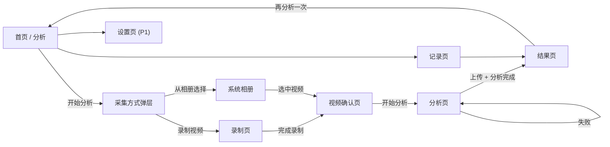
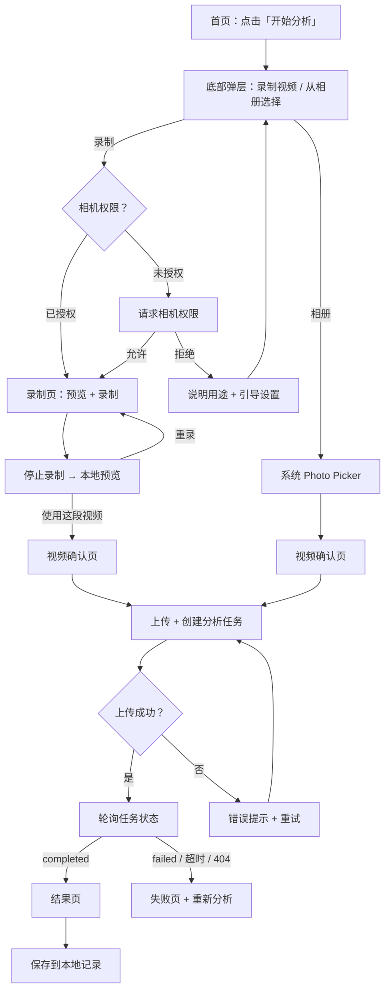
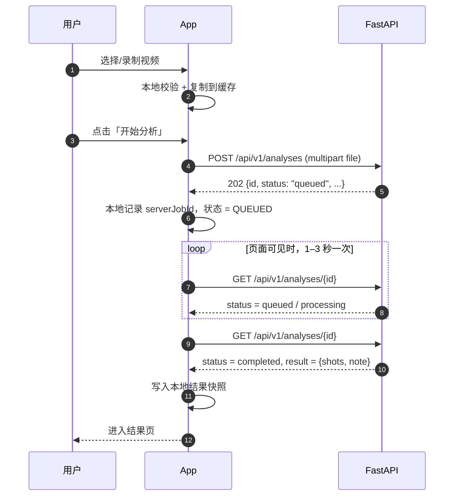
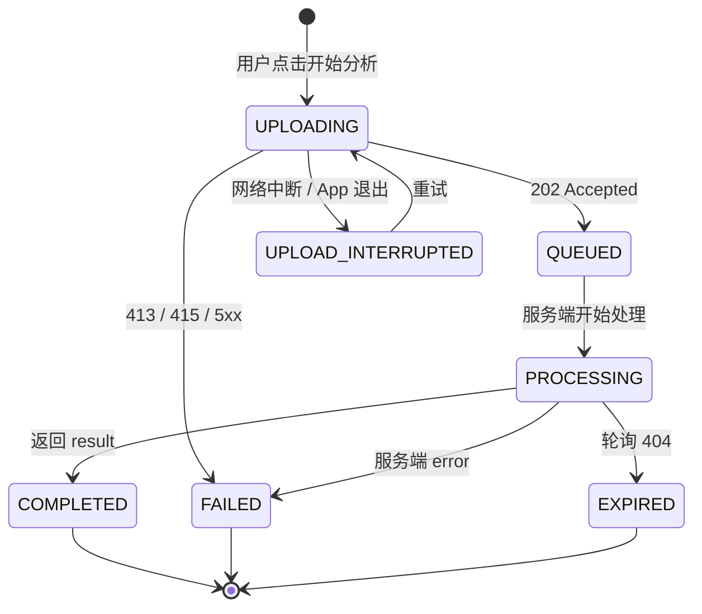

# 安卓 App 交互流程设计

> - **状态**：设计稿 v1（待评审）
> - **日期**：2026-11-05
> - **范围**：Android App 端的信息架构、核心流程、页面状态与异常处理。
> - **不包含**：服务端识别算法实现（见 [进球识别方案调研](../research/shot-recognition.md)）。
>
> **现状基线**：`android/` 目前只有单页脚手架（`HomeScreen` 展示进度和服务端连通性检查），
> 还没有视频采集、上传、分析和结果界面；服务端已提供视频上传与任务查询接口。

## 1. 背景与目标

### 1.1 要解决的问题

用户在场边打完球，想知道「进了几个球、哪几个球进了」。
App 需要把「打篮球 → 录制视频 → 自动识别进球」串成一条用户能独立走完的链路，
而不是让用户直接面对服务端接口。

### 1.2 本期目标（MVP）

一条完整、可恢复的链路：

1. 录制一段短视频，或从相册选择已有视频；
2. 上传到服务端并异步分析；
3. 查看识别结果：进球时间点、命中/未中、命中率；
4. 在本地记录中回看历史分析。

### 1.3 非目标（本期不做）

- 端侧实时识别（第二阶段）；
- 账号体系、云端历史、多设备同步；
- 社交分享、排行榜、球队管理；
- 多人/多球统计、战术分析；
- 付费与订阅。

### 1.4 设计原则

| 原则 | 含义 | 落地方式 |
| --- | --- | --- |
| 快 | 从打开 App 到开始分析尽量少点击 | 首页主按钮直接唤起采集方式，不强制登录/引导 |
| 可恢复 | 上传或分析中断后能重试、找回 | 本地保存任务 id 与状态；杀进程后可恢复 |
| 诚实 | 不把「没识别到」说成「0 进球」 | 空结果、`note`、失败分别呈现；结果页常驻误差提示 |
| 单手可用 | 场边单手操作 | 主操作放在屏幕下半部；底部弹层、大按钮 |
| 省流 | 视频大、球馆网络差 | 上传前校验与提示、进度可见、支持取消 |

## 2. 用户与场景

### 2.1 目标用户

- **主要**：业余球员本人。练球时把手机架在场边或让同伴帮拍，想快速回看命中情况。
- **次要**：教练或队友。帮别人拍完顺便看结果，不一定会长期使用。

### 2.2 关键场景

| 场景 | 环境 | 交互诉求 |
| --- | --- | --- |
| 自己练球 | 手机靠墙/三脚架，后置镜头拍篮筐 | 少操作，录完即传 |
| 同伴帮拍 | 手持，网络一般 | 录完能预览、重录，上传不白等 |
| 相册已有视频 | 之前拍好的素材 | 直接选择，不重复录 |
| 球馆弱网 | 4G/场馆 Wi-Fi 不稳定 | 进度可见、失败可重试、可以离开页面 |
| 事后回看 | 隔一段时间 | 快速找到上次结果，不依赖服务端还在 |

### 2.3 现实约束

- 服务端任务保存在进程内存中（`server/app/services/jobs.py`），**服务重启后旧任务会 404**。
  因此历史记录必须由 App 本地保存结果快照。
- 单文件默认上限 **200 MB**；支持 `mp4/mov/m4v/webm/avi/mkv`。
- 识别在服务端离线执行，一段 30 秒视频可能需要数十秒到数分钟，界面需要管理等待预期。
- 检测器仍在迭代（当前 `main` 是占位实现，后续会升级）：任务完成时可能 `result.shots` 为空并带 `note`。
  界面必须区分「识别完成但没找到球」和「分析失败」，不能把空结果当成失败。
- 服务端接口没有鉴权、没有取消/重试接口，App 的「取消」只能是本地停止等待。

## 3. 信息架构

### 3.1 页面清单

| # | 页面 | 作用 | 入口 | 优先级 |
| --- | --- | --- | --- | --- |
| 1 | 首页 | 开始分析、最近结果、服务状态 | 启动 App | P0 |
| 2 | 采集方式弹层 | 选择「录制视频」或「从相册选择」 | 首页「开始分析」 | P0 |
| 3 | 录制页 | 相机预览、录制、停止、重录 | 采集方式弹层 | P0 |
| 4 | 视频确认页 | 预览视频、查看文件信息、开始分析 | 录制完成 / 相册选择 | P0 |
| 5 | 分析页 | 上传进度 + 服务端任务状态轮询 | 视频确认页 | P0 |
| 6 | 结果页 | 结果概要、播放器标记、事件列表 | 分析完成 / 历史记录 | P0 |
| 7 | 记录页 | 历史分析列表 | 底部导航 | P0 |
| 8 | 设置页 | 服务端地址、清除记录、关于 | 首页右上角 | P1 |

### 3.2 导航结构

底部导航只保留两个一级目的地：**分析（首页）** 和 **记录**。
进入采集流程后隐藏底部导航，让用户专注于当前任务。



### 3.3 返回键与导航规则

| 当前页面 | 返回行为 |
| --- | --- |
| 首页 | 退出 App（Android 默认行为） |
| 采集方式弹层 | 关闭弹层，回首页 |
| 录制中 | 弹确认「放弃这段录制？」 |
| 录制完成预览 | 放弃当前视频，回录制页 |
| 视频确认页 | 返回来源页（录制页或首页） |
| 上传中 | 弹确认「取消上传？」→ 中止上传并回视频确认页（视频保留） |
| 分析中 | 提示「分析会在后台继续，可在记录中查看」→ 回首页 |
| 结果页 | 回到来源页（首页或记录页） |
| 记录页 | 回首页 |
| 设置页 | 回首页 |

- 分析流程使用独立导航栈，避免误触底部导航导致状态丢失。
- 结果页进入时清除「分析中」页面，防止返回重复提交。

## 4. 核心流程

### 4.1 主流程：录制并分析



### 4.2 主流程步骤说明

| 步骤 | 用户动作 | App 行为 | 失败处理 |
| --- | --- | --- | --- |
| 1 | 点击「开始分析」 | 弹出采集方式底部弹层 | — |
| 2 | 选择「录制视频」 | 检查/请求相机权限，打开录制页 | 拒绝时说明用途，可去设置 |
| 3 | 录制 | 显示计时、最长时长进度；可停止/取消 | 相机占用、存储不足时提示 |
| 4 | 停止 | 生成 MP4 到应用缓存，进入预览 | 文件异常时提示重录 |
| 5 | 确认视频 | 展示时长、大小、文件名；校验格式/大小 | 不通过时禁止「开始分析」 |
| 6 | 开始分析 | 自动上传，显示字节进度 | 中断可重试（整段重传） |
| 7 | 等待 | 轮询 `GET /analyses/{id}`，展示排队/识别中 | 网络错误自动重试，可离开页面 |
| 8 | 查看结果 | 展示概要、时间轴、事件列表 | 空结果显示说明与拍摄建议 |

### 4.3 相册选择流程

1. 使用系统 **Photo Picker**（`ActivityResultContracts.PickVisualMedia`）；
   低版本设备由官方兼容方案回退到系统文件选择器；**不需要存储权限**。
2. 选中后读取 `content://` URI 的显示名、大小、时长；校验扩展名与大小。
3. **把视频复制到应用缓存**后再进入确认页：
   - 避免进程被杀或 URI 授权失效后无法重试；
   - 复制前检查剩余空间（视频最大 200 MB）；
   - 用户确认放弃或删除记录时删除副本，不动相册原文件。
4. 相册里的视频可能很长：超过 60 秒只提示「视频较长，分析时间会更久」，不强制拦截；
   超过 200 MB 直接拦截。

### 4.4 历史回看流程

1. 记录页读取本地数据库，按创建时间倒序展示。
2. 点击一条记录：
   - `completed`：直接打开结果页（使用本地快照，不依赖服务端）；
   - `processing`/`queued`：进入分析页并立即恢复轮询；
   - `failed`/`expired`：打开失败详情，提供「重新分析」；
   - `uploading` 且进程已重启：标记为「上传中断」，提供重试。
3. 服务端任务 404 时，把本地记录标记为「服务端任务已失效」，结果快照仍可查看。

### 4.5 与服务端交互时序



- 上传时 `multipart` 字段名必须是 `file`，文件名必须带扩展名（服务端用扩展名判断格式）。
- 轮询在页面可见时进行；离开页面或 App 进入后台时停止请求，服务端任务不受影响。

### 4.6 中断与恢复

| 中断 | App 行为 | 恢复方式 |
| --- | --- | --- |
| 上传中断（切后台/断网） | 保留本地视频和上传状态，提示「上传已暂停」 | 回页面或点「继续上传」 |
| 分析中离开页面 | 停止轮询，记录状态保持 `processing` | 回记录页/分析页时恢复轮询 |
| App 进程被杀 | 启动时扫描本地 `uploading` 记录，标记「上传中断」 | 用户手动重试 |
| 服务端重启 | 轮询返回 404 | 标记「任务已失效」，提供重新分析 |
| 网络短暂波动 | 保留最后一次状态，指数退避重试 | 网络恢复后自动继续 |

## 5. 页面设计

### 5.1 首页

**目的**：让用户一眼知道能做什么，并提供「开始分析」和「最近结果」两个入口。

```text
┌──────────────────────────────────┐
│  篮球进球识别                ⚙︎   │
│  录制或选择一段视频，自动识别进球    │
│                                  │
│  ┌────────────────────────────┐  │
│  │      ●  开始分析            │  │
│  └────────────────────────────┘  │
│                                  │
│  最近一次                         │
│  ┌────────────────────────────┐  │
│  │ 今天 18:20 · 识别 5 球 中 3  │  │
│  │ 查看结果 ›                  │  │
│  └────────────────────────────┘  │
│                                  │
│  服务端：在线 · 点击检查           │
│                                  │
│   [ 分析 ]          [ 记录 ]      │
└──────────────────────────────────┘
```

**状态**：

| 状态 | 表现 |
| --- | --- |
| 首次使用 | 主按钮 + 一行三步说明：「录制 → 上传 → 查看进球」，不显示最近记录卡片 |
| 有历史 | 展示最近一条记录摘要（时间、识别球数、命中数、状态） |
| 服务不可用 | 顶部或底部出现提示条「服务端连接失败」+「重试」；仍可查看本地记录 |
| 检查中 | 状态行显示「检查中…」，不阻塞其他操作 |

**交互**：

- 「开始分析」：打开采集方式底部弹层。
- 最近记录卡片：打开结果页；处理中则打开分析页。
- 服务状态行：点击手动重新检查 `/api/v1/health`；启动和回到前台时自动检查一次。
- 右上角设置：P1 上线；MVP 可先隐藏，保留入口位置。

### 5.2 采集方式弹层

底部 `ModalBottomSheet`，两个大尺寸选项：

| 选项 | 说明 | 图标 |
| --- | --- | --- |
| 录制视频 | 打开相机，现场拍一段 | 摄像机 |
| 从相册选择 | 选择手机里已有的视频 | 相册 |

- 点击遮罩或下滑关闭。
- 不记住上次选择，避免用户误以为会直接开相机。
- 若相机不可用（无摄像头/被占用），「录制视频」置灰并说明原因。

### 5.3 录制页

**目的**：用最少的操作完成一次可用的投篮视频采集。

**布局**（全屏预览）：

```text
┌──────────────────────────────────┐
│ ✕                     ⚡ 切换镜头  │
│                                  │
│                                  │
│          相机实时预览              │
│                                  │
│                                  │
│            00:08 / 00:30          │
│           ● 录制中   [ 停止 ]      │
└──────────────────────────────────┘
```

**权限流程**：

1. 进入页面先检查 `CAMERA`。
2. 未授权：展示用途说明（「用于拍摄投篮视频，视频只会在你点击分析后上传」）→ 请求权限。
3. 拒绝一次：再次点击录制时展示解释，并提供「去设置」。
4. 永久拒绝：直接引导到系统设置页。
5. `RECORD_AUDIO` 为可选权限：拒绝时仍可录制无声视频，并提示一次「未授权麦克风，将录制无声视频」。

**录制规则**：

- 默认后置主摄；支持前后镜头切换、手电筒开关（设备支持时）。
- 最长 **30 秒**（可配置常量）；进度环显示剩余时间，最后 5 秒数字变强调色。
- 少于 **1 秒** 停止时不生成视频，提示「录制时间太短」。
- 录制中接电话/App 退到后台：自动停止并保留已录内容；回到前台进入预览。
- 视频写入应用缓存：`cacheDir/videos/rec_<timestamp>.mp4`，编码 H.264 + AAC（无麦克风时仅视频）。

**状态**：

| 状态 | 界面 |
| --- | --- |
| 请求权限中 | 预览区域占位 + 「正在请求相机权限…」 |
| 权限被拒 | 说明卡片 +「去设置」/「返回」 |
| 准备中 | 预览黑屏 + loading |
| 录制中 | 计时、停止按钮、录制红点 |
| 处理中（停止后） | 「正在生成视频…」 |
| 预览 | 播放器 +「重录」/「使用这段视频」 |
| 相机错误 | 错误说明 +「重试」/「返回」 |

### 5.4 视频确认页

**目的**：上传前让用户确认内容，并尽早暴露格式/大小问题。

**布局**：

- 顶部：视频预览播放器（可播放/暂停，默认不自动播放）。
- 信息区：文件名、时长、大小、来源（录制/相册）。
- 校验结果：不通过时红色说明，禁用「开始分析」。
- 底部主按钮：「开始分析」；次要按钮：「重录」或「重新选择」。

**校验规则**：

| 校验 | 规则 | 不通过时 |
| --- | --- | --- |
| 格式 | 扩展名属于 `mp4/mov/m4v/webm/avi/mkv` | 「不支持该视频格式，请选择 MP4 等常见格式」 |
| 大小 | ≤ 200 MB（与服务端默认值一致） | 「视频超过 200 MB，请裁剪或换一段视频」 |
| 时长 | 读取失败不阻塞；> 60 秒仅警告 | 「视频较长，分析可能需要更久」 |
| 可读性 | 能读取元数据/首帧 | 「无法读取该视频，请换一段试试」 |

**交互**：

- 「开始分析」：创建本地记录（状态 `UPLOADING`），进入分析页并开始上传。
- 上传失败后返回本页，已选视频和校验状态保留。

### 5.5 分析页

**目的**：把「上传」和「服务端识别」两个阶段合成一个连续的等待体验。

**阶段与状态**（同一页面，按状态切换）：

| 阶段 | 界面 | 可操作 |
| --- | --- | --- |
| 上传中 | 视频缩略图、文件名、进度条 + 百分比、「取消上传」 | 取消（中止本次上传） |
| 排队中 | 进度条走满，标题「已上传，等待分析」，转圈 | 可返回首页，记录中可找回 |
| 识别中 | 标题「正在识别进球…」，已等待时间、提示文案 | 可返回首页，记录中可找回 |
| 失败 | 错误说明 +「重试」/「返回首页」 | 重试（重新上传）或放弃 |

**提示文案**（识别中轮换或固定一条）：

- 「识别在服务端进行，可以先离开，稍后到记录里查看。」
- 「视频越长，分析时间越久，请保持网络畅通。」

**进度语义**：

- 上传进度按已发送字节计算，不使用假进度。
- 服务端没有进度接口，排队/识别阶段只显示已等待时间，不显示百分比，避免误导。

**取消/离开语义**：

- 上传中点「取消上传」：中止请求，删除本地任务记录，回到确认页（视频保留）。
- 上传完成后没有「取消分析」：服务端不支持取消。返回首页时提示「分析会在后台继续」。
- 上传中断自动保留在记录中，状态为「上传中断」，可重试。

### 5.6 结果页

**目的**：让用户快速回答「进了几个」「哪几个」，并能定位到视频时刻。

**布局**：

```text
┌──────────────────────────────────┐
│ ‹  分析结果                       │
│                                  │
│  识别到 5 次投篮 · 命中 3 · 60%    │
│                                  │
│  ┌────────────────────────────┐  │
│  │        视频播放器            │  │
│  │  00:12 ──●──────●────●──    │  │
│  └────────────────────────────┘  │
│                                  │
│  #1  00:04   ✓ 命中               │
│  #2  00:12   ✓ 命中               │
│  #3  00:21   ✗ 未中               │
│  ...                             │
│                                  │
│  [ 再分析一次 ]      [ 完成 ]      │
└──────────────────────────────────┘
```

**内容规则**：

- 概要：`识别到 N 次投篮 · 命中 M · 命中率 P%`；
  `N = shots.size`，`M = shots.count { it.made }`，`P = M / N`。
  没有识别到投篮时整块换成空状态，不显示「0%」。
- 播放器：进度条上为每个 `ShotEvent` 画标记；命中与未中使用不同颜色/形状。
- 事件列表：按 `timestamp_seconds` 升序，显示序号、`mm:ss`、命中/未中徽标。
  点击一条：播放器 seek 到该时间点前 1 秒并播放。
- `result.note` 非空时，在概要下方展示说明条（例如「未检测到篮筐」）。
- 常驻免责声明（列表底部）：「识别结果可能有误，命中率仅供参考。」
- 操作：「再分析一次」回首页；「完成」返回来源页。

**特殊状态**：

| 状态 | 界面 |
| --- | --- |
| 识别完成，无投篮事件 | 插画/图标 +「没有识别到投篮」+ `note`（如有）+ 拍摄建议 |
| 识别完成，有事件 | 概要 + 播放器 + 列表 |
| 本地视频已清理 | 播放器位置显示「视频已清理」，事件列表仍可查看 |
| 服务端任务失效 | 有本地快照：正常展示 + 提示「服务端任务已失效」；无快照：「这次分析结果已不可用」+「重新分析」 |
| 分析失败 | 错误说明（`error` 或通用文案）+「重新分析」 |
| 分析超时 | 「分析时间超出预期」+「继续等待」/「重新分析」 |

**拍摄建议**（空结果时展示）：

- 尽量让篮筐和篮球同时出现在画面中；
- 保持机位稳定，避免强烈逆光；
- 视频从投篮前开始，到球落下后结束。

### 5.7 记录页

**布局**：列表，按时间倒序。

| 元素 | 内容 |
| --- | --- |
| 时间 | 今天 18:20 / 昨天 / 10月5日 |
| 标题 | 文件名或「现场录制」 |
| 状态徽标 | 上传中 / 排队中 / 识别中 / 已完成 / 失败 / 已失效 / 上传中断 |
| 摘要 | 已完成：`识别 5 球 · 命中 3`；其他：状态说明 |
| 操作 | 点击打开；右滑或长按删除（二次确认） |

**状态**：

- 空：「还没有分析记录，去录制第一段视频吧」+「开始分析」按钮。
- 有进行中的记录：列表顶部显示并可点击恢复。
- 加载：本地数据读取很快，用骨架屏即可。

**规则**：

- 记录只存本地；删除记录时一并删除应用缓存中的视频副本（不删相册原文件）。
- 进行中的记录也显示，但摘要区显示当前阶段。
- 列表不做下拉刷新；进入记录页时对 `processing` 的记录触发一次状态查询。

### 5.8 设置页（P1）

| 分组 | 项 | 说明 |
| --- | --- | --- |
| 服务端 | 服务端地址 | 真机调试用；默认 `BuildConfig.SERVER_BASE_URL`，修改后立即生效 |
| 服务端 | 连接检查 | 显示 `/health` 返回的 `version`、`detector` |
| 数据 | 清除历史记录 | 二次确认；同时删除本地视频副本 |
| 关于 | 版本号 | `BuildConfig.VERSION_NAME` |
| 关于 | 隐私说明 | 视频会上传到所配置的服务端，分析完成后可删除 |

MVP 阶段服务端地址仍由 `build.gradle.kts` 配置；设置页先把「清除记录」「关于」做出来即可。

## 6. 状态与异常

### 6.1 分析任务状态机



说明：

- `UPLOADING`、`UPLOAD_INTERRUPTED` 是 App 本地状态；其余与服务端 `JobStatus` 对应。
- `EXPIRED` 只在轮询返回 404 时使用；此时本地可能已有结果快照，仍可查看。
- 重试会创建新的服务端任务（接口没有幂等键），旧任务不删除。

### 6.2 轮询策略

| 参数 | 值 |
| --- | --- |
| 首次查询 | 收到 202 后立即 |
| 间隔 | 前 10 秒 1 秒；10–30 秒 2 秒；之后 3 秒 |
| 请求超时 | 10 秒 |
| 总等待上限 | 5 分钟；超过后提示「分析时间超出预期」，允许继续等待 |
| 网络错误 | 保留最后状态，2→4→8 秒退避，最多 15 秒；页面显示「网络中断，正在重试」 |
| 5xx | 连续 3 次失败后转为失败状态，提供重试 |
| 404 | 立即停止，标记 `EXPIRED` |
| 页面不可见 | 暂停轮询；回到前台/页面重新可见时立即查询一次 |

- 轮询只使用 `GET /api/v1/analyses/{id}`，不重复上传。
- 分析页与记录页共享同一个状态源，避免两个页面各自轮询。

### 6.3 错误与边界矩阵

| 场景 | 触发条件 | 界面表现 | 用户可做的事 | 文案 |
| --- | --- | --- | --- | --- |
| 相机权限被拒 | 用户拒绝一次 | 录制页说明卡片 | 再次请求、去设置 | 「需要相机权限才能拍摄投篮视频」 |
| 相机权限永久拒绝 | 「不再询问」 | 说明 + 去设置 | 去系统设置 | 「请在系统设置中开启相机权限」 |
| 麦克风权限被拒 | 用户拒绝 | 录制页轻提示 | 继续录制（无声） | 「未授权麦克风，将录制无声视频」 |
| 相机被占用/初始化失败 | CameraX 错误 | 错误页 | 重试、返回 | 「相机启动失败，请关闭其他占用相机的应用后重试」 |
| 存储空间不足 | 复制/录制前检查 | 弹窗 | 清理空间 | 「存储空间不足，无法保存视频」 |
| 格式不支持 | 扩展名不在白名单 | 确认页红色提示 | 重新选择 | 「不支持该视频格式，请选择 MP4 等常见格式」 |
| 文件过大 | > 200 MB | 确认页红色提示 | 重新选择 | 「视频超过 200 MB，请裁剪或换一段视频」 |
| 无法读取视频 | 元数据/首帧失败 | 确认页红色提示 | 重新选择 | 「无法读取该视频，请换一段试试」 |
| 无网络 | 上传前检测 | 提示条 | 重试 | 「当前没有网络连接」 |
| 上传中断 | 网络/切后台 | 分析页「上传中断」 | 重试 | 「上传中断，请检查网络后重试」 |
| 413 | 服务端大小限制 | 分析页失败 | 换视频 | 「视频超过服务端大小限制」 |
| 415 | 服务端格式限制 | 分析页失败 | 换视频 | 「服务端不支持该视频格式」 |
| 5xx | 服务端异常 | 分析页失败 | 重试 | 「服务暂时不可用，请稍后重试」 |
| 任务 404 | 服务端重启/任务丢失 | 结果/记录页失效态 | 重新分析 | 「这次分析结果已不可用」 |
| 分析失败 | `status=failed` | 失败态 + `error` | 重新分析 | 「分析失败：{error}」 |
| 分析超时 | 超过 5 分钟 | 超时态 | 继续等待、重新分析 | 「分析时间超出预期」 |
| 空结果 | `shots` 为空 | 空状态 + `note` | 查看建议、重新分析 | 「没有识别到投篮」 |
| 本地视频已清理 | 记录在但文件被删 | 播放器位置占位，列表仍可看 | 查看事件、重新分析 | 「视频已清理」 |

### 6.4 权限流程

| 权限 | 使用场景 | 请求时机 | 拒绝后的处理 |
| --- | --- | --- | --- |
| `CAMERA` | 录制视频 | 首次进入录制页 | 说明用途，再次请求；永久拒绝引导设置 |
| `RECORD_AUDIO` | 录制带声音的视频 | 首次开始录制前 | 允许无声录制，不阻塞 |
| 相册访问 | 选择视频 | — | 使用 Photo Picker，无需权限 |

- 不在 App 启动时批量申请权限。
- 权限说明使用一句话，避免长段落。

### 6.5 生命周期与进程恢复

- **持久化时机**：创建本地记录、收到 202、每次状态变化、结果写入、失败原因。
- **启动恢复**：
  - `UPLOADING` 记录 → 标记 `UPLOAD_INTERRUPTED`；
  - `QUEUED`/`PROCESSING` 记录 → 保持状态，进入记录页或分析页时恢复轮询；
  - 其余状态不动。
- **本地视频副本**：
  - 随记录保留：结果页播放、重新分析和重试都需要它；
  - 用户删除记录时清理；
  - 长期未打开的记录可在设置页提示清理，不做静默删除。
- **屏幕旋转**：MVP 建议锁定竖屏；视频播放器横屏全屏放 P1。

## 7. 数据与接口

### 7.1 客户端数据模型

```kotlin
enum class AnalysisStatus {
    UPLOADING, UPLOAD_INTERRUPTED, QUEUED, PROCESSING,
    COMPLETED, FAILED, EXPIRED
}

enum class VideoSource { RECORD, GALLERY }

data class ShotEvent(
    val timestampSeconds: Double,
    val frameIndex: Int,
    val made: Boolean,
)

data class AnalysisResult(
    val detector: String,
    val shots: List<ShotEvent>,
    val note: String?,
)

data class AnalysisRecord(
    val localId: String,           // 本地主键
    val serverJobId: String?,      // 上传成功后写入
    val createdAt: Instant,
    val source: VideoSource,
    val localVideoUri: String?,    // 应用缓存副本，重试/回看用
    val filename: String,
    val sizeBytes: Long,
    val durationMs: Long?,
    val status: AnalysisStatus,
    val result: AnalysisResult?,
    val error: String?,
)
```

- `result` 以 JSON 列或子表保存；列表只读概要字段，结果页按需加载完整结果。
- 服务端 `created_at` 用于展示时统一转换为本地时区。

### 7.2 接口映射

| 时机 | 请求 | 处理 |
| --- | --- | --- |
| 首页启动/回前台 | `GET /api/v1/health` | 更新服务状态；失败不阻塞页面 |
| 点击「开始分析」 | `POST /api/v1/analyses`，multipart 字段 `file` | 202 → 保存 `id`，进入 `QUEUED` |
| 轮询 | `GET /api/v1/analyses/{id}` | 更新状态；`completed` 写入结果快照 |
| 记录页恢复 | 同上 | 仅对 `QUEUED`/`PROCESSING` 记录执行 |

**请求细节**：

- `Content-Type: multipart/form-data`，字段名 `file`，文件名必须带扩展名。
- 上传超时：连接 10 秒、写入 5 分钟、读取 30 秒（大文件弱网场景）。
- 不做视频转码/压缩：MVP 原样上传，避免画质影响识别和额外耗时。
- 上传进度按请求体已写字节回调；不支持进度时退化为不确定进度条。

**错误映射**：

| HTTP | 含义 | App 处理 |
| --- | --- | --- |
| 202 | 已创建任务 | 正常轮询 |
| 413 | 文件过大 | 失败态，建议换视频 |
| 415 | 格式不支持 | 失败态，建议换视频 |
| 404 | 任务不存在 | `EXPIRED` |
| 5xx | 服务端错误 | 重试 3 次后失败 |

### 7.3 本地持久化

- 使用 Room 保存 `AnalysisRecord`；设置项用 DataStore。
- 服务端任务存在内存中，本地记录是**唯一可靠的历史来源**。
- 「刷新」只对仍有 `serverJobId` 且未失效的记录执行；本地快照永远可读。
- 删除记录为软删除或直接删除 + 清理视频文件；删除前二次确认。

### 7.4 文件处理

| 场景 | 处理 |
| --- | --- |
| 录制 | `cacheDir/videos/rec_<timestamp>.mp4`，MP4/H.264 |
| 相册选择 | 复制到 `cacheDir/videos/import_<timestamp>.<ext>` |
| 文件名 | 保留扩展名；相册文件无扩展名时按 MIME 推断（`video/mp4` → `.mp4`） |
| 大小检查 | 复制前用 `ContentResolver` 查询 `OpenableColumns.SIZE`，未知时复制后再检查 |
| 清理 | 随记录保留；删除记录时清理；不删除相册原文件 |

## 8. 视觉、文案与可访问性

### 8.1 视觉

- 延续现有 Material 3 + 橙色篮球主题（`ui/theme/Theme.kt`），支持深色/浅色。
- 命中/未中不能只靠颜色区分：同时使用 ✓/✗ 图标和文字。
- 主要操作使用 `FilledTonalButton`/`Button`，次要操作使用文本按钮。
- 底部导航使用 `NavigationBar`，仅两个 Tab。
- 结果页播放器占上半屏，事件列表可滚动；横屏全屏播放 P1。

### 8.2 关键文案

| 位置 | 文案 |
| --- | --- |
| 首页标题 | 篮球进球识别 |
| 首页副标题 | 录制或选择一段视频，自动识别进球 |
| 主按钮 | 开始分析 |
| 弹层选项 | 录制视频 / 从相册选择 |
| 录制停止 | 停止 |
| 录制完成 | 使用这段视频 / 重录 |
| 确认页主按钮 | 开始分析 |
| 分析中（排队） | 已上传，等待分析 |
| 分析中（识别） | 正在识别进球… |
| 分析中提示 | 识别在服务端进行，可以先离开，稍后到记录里查看 |
| 结果概要 | 识别到 {n} 次投篮 · 命中 {m} · {p}% |
| 空结果 | 没有识别到投篮 |
| 免责声明 | 识别结果可能有误，命中率仅供参考 |
| 记录页空态 | 还没有分析记录，去录制第一段视频吧 |
| 上传中断 | 上传中断，请检查网络后重试 |
| 任务失效 | 这次分析结果已不可用 |

- 所有用户可见文案放 `res/values/strings.xml`，不在 Compose 里硬编码。
- 数量、时间、百分比使用本地化格式。

### 8.3 可访问性

- 所有可点击元素 ≥ 48dp；录制按钮和停止按钮尤其要大。
- 图标按钮提供 `contentDescription`（如「关闭」「切换镜头」「手电筒」）。
- 结果列表项的 TalkBack 朗读：「第 2 球，00:12，命中」。
- 进度、状态变化通过 `liveRegion` 或 Snackbar 播报。
- 不只靠颜色传达命中/未中；支持系统字体放大，避免固定高度导致截断。
- 视频播放器控件可键盘/辅助功能操作（Media3 默认支持）。

## 9. 埋点与指标（P1，待接入）

| 事件 | 参数 | 用途 |
| --- | --- | --- |
| `analysis_started` | source、duration、size | 漏斗起点 |
| `upload_result` | success、fail_reason、duration | 上传成功率与弱网表现 |
| `analysis_result` | status、elapsed_ms、shots、made | 任务完成率、识别分布 |
| `result_action` | action（reanalyze/finish） | 结果页满意度信号 |

MVP 不接第三方统计 SDK；可先用 `Log.d` 记录，后续统一接入。

## 10. 实施拆分与验收

### 10.1 里程碑

**P0（MVP 可用）**

1. 导航骨架：Compose Navigation + 底部两个 Tab。
2. 首页改版：主按钮、最近记录、服务状态。
3. 采集方式弹层。
4. CameraX 录制页（权限、录制、预览、重录）。
5. Photo Picker 相册选择 + 本地复制。
6. 视频确认页与校验。
7. 上传（multipart、进度、取消）与轮询。
8. 结果页（概要、播放器标记、事件列表、空/失败态）。
9. 本地历史记录（Room、删除、进程恢复）。

**P1（体验完善）**

- 设置页（服务端地址、清除记录、关于）；
- 结果人工纠正（本地覆盖 `made`，不写回服务端）；
- 后台完成通知；
- 缩略图/首帧、横屏全屏播放；
- 上传断点续传（当前为整段重传）。

**P2（后续阶段）**

- 端侧实时识别；
- 账号与云端历史；
- 分享、多人统计。

### 10.2 验收清单

- [ ] 从首页最多 3 次点击进入录制/相册流程。
- [ ] 相机权限允许、拒绝一次、永久拒绝三条路径都有明确出口。
- [ ] 录制 30 秒自动停止；少于 1 秒不生成视频；重录可用。
- [ ] 相册选择不需要存储权限；格式/大小不合法时无法开始分析。
- [ ] 上传过程显示真实字节进度；取消后不创建残留记录。
- [ ] 上传成功后轮询并正确展示排队/识别/完成/失败。
- [ ] 结果页时间轴标记与事件列表一致；点击事件能跳转到对应时间。
- [ ] 空结果时展示说明和拍摄建议，不显示「0% 命中率」。
- [ ] 服务端 404/失败/超时都有可操作的失败态。
- [ ] 分析中离开页面、杀进程、重新打开 App 后能恢复或找回记录。
- [ ] 深色/浅色模式、字体放大、TalkBack 下主要流程可用。
- [ ] 删除记录会清理本地视频副本，不影响相册原文件。

## 11. 待确认问题

1. 录制时长上限 30 秒是否合适？还是改成 60 秒、只做提示不强制？
2. 历史记录本期只存本地是否可接受？是否需要尽早引入账号/云同步？
3. 「人工纠正」是否要提前到 MVP？（当前设计放在 P1）
4. 是否需要在设置页暴露服务端地址给普通用户，还是只保留开发者入口？
5. 分析失败后的「重试」是整段重传（当前设计），是否接受？断点续传放 P1。
6. 本地视频是否随记录长期保留？当前设计保留到用户删除记录（结果页播放和重试都需要），代价是占用缓存；是否需要自动清理周期？
