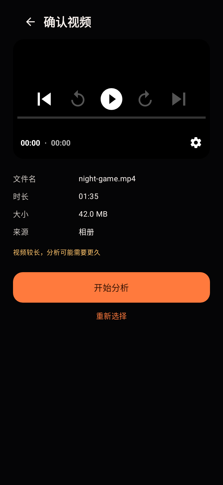
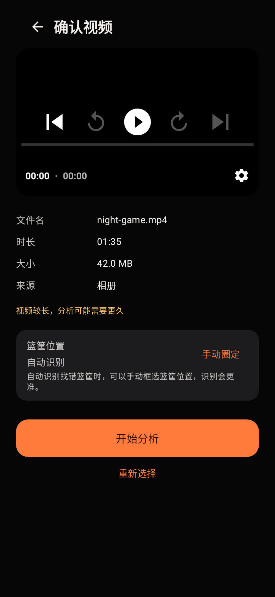
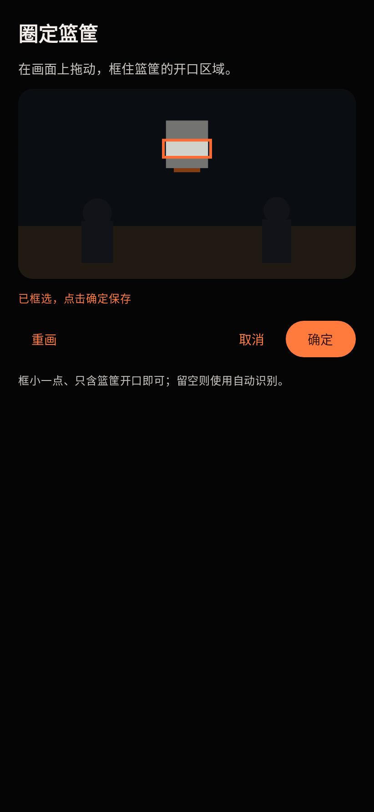

# 手动圈定篮筐：改动前后视觉证据

- **基线版本**：`origin/main` @ `05ddd89`（PR #7 合并后）
- **改动版本**：`agent/report-fixes-hoop-roi-0499ae46b965`
- **场景**：确认视频页，同一段 95 秒测试视频、`w411dp-h891dp-xhdpi` 视口、
  黑色主题、未圈定篮筐（自动识别）状态。
- **采集方式**：`ReviewScreenshotTest` / `ReviewBaselineScreenshotTest` 在
  Robolectric 下渲染真实 Compose UI 并截图；两个版本使用同一测试代码结构。

| 改动前 | 改动后 |
| --- | --- |
|  |  |

- `before-review.png`：基线确认页没有「篮筐位置」区域。
- `after-review.png`：新增「篮筐位置 · 自动识别」卡片和「手动圈定」入口。
- `after-hoop-picker.png`（下方）：点击「手动圈定」后的取帧框选界面；用户拖动
  矩形框住篮筐开口，确定后以归一化坐标随上传提交。

说明：框选界面截图中的球场画面由测试绘制，因为单元测试环境没有可解码的真实
视频；正式 App 中显示的是从用户视频提取的首帧。UI 本身是实际 Compose 实现。
