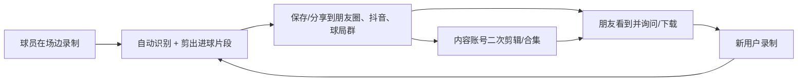

# 篮球进球识别 App 推广运营策略（个人开发者版）

> - **适用产品**：`com.feiying.basketball`（安卓 0.6.0 / 服务端 0.6.0）
> - **文档版本**：v1.0，2026-11-14
> - **适用对象**：一人开发、没有市场团队、90 天现金预算不超过 ¥5,000 的独立开发者
> - **范围**：定位、渠道、内容、产品运营、商业化与合规上架；不包含算法实现
> - **事实基线**：App 尚未上架；识别为经典 CV 基线；首批真实视频评估中，命中事件精确率
>   100%、命中召回率 42.9%（2 段视频、7 个命中事件），**尚未达到验收目标**；当前没有
>   分享、埋点、崩溃上报、账号注销和站内协议入口。这些事实决定了本策略的先后顺序：
>   **先把「可信」和「可传播」补齐，再谈放量。**

---

## 0. 一页结论

1. **先不要投流。** 当前产品还不能承诺「数得准」，投流只会把识别误差放大成差评。
2. **卖点从「统计命中率」换成「自动剪进球集锦」。** 首批评估里命中事件精确率 100%，
   意思是「报出来的进球基本是真的」；命中召回率只有 42.9%，意思是「会漏球」。所以对外承诺
   「帮你把确认的进球剪出来」，而不是「准确统计你进了几个」。
3. **主战场是「球馆/训练营 + 小红书/抖音内容 + 应用商店」，私域承接。** 一个人做不了
   全平台矩阵，先在一个城市、一个场景、一个用户群打透。
4. **90 天目标**：100 名种子用户、1,000 次安装、300 MAU、每周 30–50 条进球片段被保存或
   分享、3 家球馆/训练营合作、NPS ≥ 30。目标是假设，跑两周后用真实基线修正。
5. **前 90 天不向 C 端收费。** 用 3 家球馆/训练营的 B2B 试点验证付费意愿，避免在留存
   没验证前就处理支付、退款、发票和商店虚拟支付合规。
6. **三条红线**：不夸大识别准确率；不未经授权使用用户视频和肖像；不在未备案、无隐私
   政策的情况下上架。

### 0.1 现在就能做的 10 件事

- [ ] 把产品一句话改成「手机架场边，自动找出进球并剪成集锦」，所有物料统一。
- [ ] 用 20 段真实视频跑一遍评估，记录命中精确率/召回率，作为上线门槛和宣传口径。
- [ ] 在 App 里补「用户协议 / 隐私政策」入口、账号注销、意见反馈三个合规与运营入口。
- [ ] 加最小埋点：安装、注册、开始分析、分析完成、保存片段、分享、反馈、崩溃。
- [ ] 做「保存/分享进球片段」的分享卡片（带水印和下载二维码），这是增长循环的起点。
- [ ] 把生产环境按 `docs/deployment-verification.md` 部署到阿里云，配好 HTTPS、短信和限流。
- [ ] 准备应用商店素材：图标、5 张真实截图、30 秒演示、短/长描述、隐私政策 URL、备案号。
- [ ] 列出本地 10 家球馆/训练营，按附录 C 的话术约 3 家做「免费 AI 集锦角」。
- [ ] 建一个 50 人以内的小红书/微信种子群，承诺每周更新、优先修问题。
- [ ] 定好每周复盘时间（建议周日晚上 30 分钟），只看 6 个指标，不做无数据决策。

---

## 1. 产品与现状

### 1.1 产品是什么

用户把手机架在场边录一段打球视频（或从相册选一段），上传后服务端识别投篮事件，返回
命中/未中时间点，并把每个命中的球剪成前后各 5 秒的片段；用户在 App 里回看、保存到相册。
核心链路已经在 0.6.0 跑通：

```text
录制/选视频 → 校验 → 上传 → 服务端识别 → 结果页（时间轴/命中率）→ 进球片段播放/保存
```

它**不是**：实时投篮追踪器、专业投篮训练系统、赛事数据平台、社交约球产品。
这四条边界在推广时要说清楚，避免用户带着错误预期下载。

### 1.2 已有能力与推广缺口

| 能力 | 现状 | 对推广的影响 |
| --- | --- | --- |
| 安卓录制/相册导入 | 已有，最长 20 分钟、200 MB | 可支撑「录一段就分析」的内容演示 |
| 手机号账号体系 | 已有，短信验证码注册/登录/改密 | 合规成本（短信、实名、隐私）已存在 |
| 手动圈定篮筐 | 已有 | 可做「自动找错筐？手动圈一下」的教程内容 |
| 结果页/历史记录 | 已有，本地 Room 快照 | 可做「训练记录」叙事，但精度不足时不要强调命中率 |
| 进球片段播放/保存 | 已有，服务端 ffmpeg 生成 | **核心传播素材**，但只能保存到相册，不能直接分享 |
| 分享/导出带水印 | **缺失** | 增长循环断点，P0 |
| 埋点/崩溃上报 | **缺失** | 无法判断渠道和留存，P0 |
| 账号注销/协议入口 | **缺失**（注册页只有勾选文案） | 上架与合规硬门槛，P0 |
| 免登录试用 | **缺失**（启动即登录门禁） | 直接拉低激活率，建议 P0 评估 |
| 手动纠正识别结果 | **缺失** | 准确率不足时的信任补救，P1 |
| iOS / 小程序 / Web | **缺失** | 90 天内不做 iOS；小程序作为后续实验 |
| 支付/会员 | **缺失** | 前 90 天不做 C 端付费 |

### 1.3 质量现状：先承认限制

首批真实视频评估（`docs/research/shot-eval-first-batch.md`）的结论是：classical 检测器
事件精确率 100%、召回率 50%；命中精确率 100%、命中召回率 42.9%；7.3 秒手持横移片段
完全不可用。产品文档里的验收目标是命中精确率 ≥ 95%、召回率 ≥ 90%，目前还差得远。

推广上的直接含义：

- **可以讲**：「报出来的进球，基本不会错」「自动帮你把进球找出来剪好」。
- **不能讲**：「准确统计命中率」「一个不漏」「专业级数据分析」。
- **必须讲**：测试版、可能漏检、建议固定机位、篮筐和球员同时入镜、可手动圈筐。
- **产品门槛**：在 20 段以上、50 个以上事件的真实视频上，命中精确率 ≥ 95% 才适合公开
  宣传「可信」；召回率 ≥ 70% 才适合把「统计命中率」作为卖点。达不到就继续以「集锦」
  为卖点，并明确标注 Beta。

### 1.4 用户与场景

**主要用户（P0）**：18–30 岁、每周打 1–3 次球的业余球员。已经会自己拍视频/让朋友帮拍，
打完想回看进球，但不会剪视频、也不想在一段 40 分钟的视频里找那几个球。

**次要用户（P1）**：教练、训练营、球馆。需要给学员/顾客产出内容，愿意为「省时间」付费。

| 场景 | 用户真正想要的 | 当前产品能否满足 |
| --- | --- | --- |
| 自己练球，手机架场边 | 录完自动找出进球，剪成可发朋友圈的片段 | 能，但漏检和机位要求要提前说明 |
| 约球/半场 3v3，朋友帮拍 | 快速拿到本场高光，不想剪 | 能，片段是核心价值 |
| 教练带训练 | 给学员看动作和命中情况 | 部分能；统计不准，先做集锦 |
| 球馆做宣传 | 给顾客/场馆账号产出内容 | 能，B2B 合作切入点 |
| 回看历史 | 找上次的结果 | 能，本地历史 |

用户现有的替代方案：自己数、让同伴记、用剪映手动剪、买智能投篮设备、用海外训练 App。
你的优势不是「更专业」，而是「不用买设备、不用学剪辑、手机拍完就出片」。

### 1.5 替代方案与竞争

| 替代方案 | 优势 | 劣势 | 你的切入点 |
| --- | --- | --- | --- |
| 自己数/同伴记 | 零成本 | 不准、容易忘、没有片段 | 自动出片，省时间 |
| 剪映等手动剪辑 | 完全可控 | 找球、剪 10 个片段要半小时以上 | 一键出集锦 |
| 智能投篮设备/场馆系统 | 数据准、可连续统计 | 贵、要场地/硬件、普通玩家没有 | 零硬件、手机即可 |
| 海外 AI 篮球训练 App（如 HomeCourt） | 训练体系成熟、订阅模式验证过 | 中文/国内网络/支付/球馆场景不适配 | 本地化、轻量、便宜 |
| 赛事/约球类 App | 流量和赛事资源 | 不做个人训练集锦 | 不正面竞争，做他们的补充 |

**结论**：不要在「专业数据」上竞争，在「手机视频 → 自动集锦 → 可分享」上做透。

### 1.6 SWOT

| 优势 S | 劣势 W |
| --- | --- |
| 全链路自己写，迭代快；无硬件成本；中文；片段直接可看；服务端可快速换模型 | 准确率未达标；只有安卓；无分享/埋点；一人时间有限；无品牌 |
| 机会 O | 威胁 T |
| 业余篮球人口大、短视频表达欲强；球馆/训练营缺内容；同类 C 端产品少 | 大厂/赛事 App 复制；平台内容限流；识别事故引发差评；合规成本；季节波动 |

---

## 2. 定位与目标

### 2.1 一句话定位

> **给业余篮球爱好者的「进球集锦相机」：手机架场边录一段，自动找出进球并剪成可分享的
> 片段，不用买设备、不用会剪辑。**

三个支撑点：

1. **省时间**：不用在长视频里找球，自动出片。
2. **零门槛**：一部安卓手机 + 一个能架手机的位置。
3. **可分享**：进球片段是天然的社交货币（分享功能需补）。

**不要用的定位**：「AI 精准投篮分析」「专业投篮训练系统」「篮球数据平台」。这些会把
用户预期拉到当前精度做不到的位置。

### 2.2 品牌名

当前名称「篮球进球识别」是功能描述，不利于记忆和搜索。建议在 90 天内定一个短品牌名，
但要先做三件事：应用商店重名查询、中国商标网近似查询、域名/公众号/小红书号可用性查询。

候选方向（仅示例，需查重后决定）：

| 候选 | 含义 | 风险 |
| --- | --- | --- |
| 篮迹 | 篮球轨迹/记录 | 可能重名，需查 |
| 进球了 | 口语、好记 | 通用词，商标弱 |
| 准星 | 投篮瞄准 | 可能与装备/游戏重名 |
| 手感 | 球员常用词 | 通用词，搜索竞争大 |
| 篮筐相机 | 功能直白 | 偏工具，缺情绪 |

命名原则：2–3 个汉字、能读、能搜、能注册；应用商店标题可采用
「品牌名 - 自动剪进球集锦」的形式兼顾搜索。

### 2.3 用户分层与优先级

| 层级 | 人群 | 90 天优先级 | 获取方式 | 付费潜力 |
| --- | --- | --- | --- | --- |
| P0 | 18–30 岁业余球员（练球/约球） | 最高 | 小红书/抖音、球馆、朋友转发 | 低（先免费） |
| P1 | 教练/训练营 | 高 | 球馆转介绍、训练营合作 | 中（B 端试点） |
| P2 | 球馆/赛事主办方 | 中 | 线下拜访、赛事合作 | 中高（B 端） |
| P3 | 校园篮球社/院队 | 中 | 校园大使、赛事 | 低 |

90 天内不要试图覆盖「所有打篮球的人」。先服务好一个城市里「本来就会拍视频」的 100 个人。

### 2.4 北极星指标与 90 天目标

**北极星指标**：每周产生并保存/分享进球片段的用户数（Weekly Clip Makers）。
它同时代表「产品有用」和「内容可传播」，比安装量更接近真实价值。

| 指标 | 90 天目标（假设） | 说明 |
| --- | ---: | --- |
| 种子用户（完成 ≥1 次分析） | 100 | 人工邀请 + 球馆 |
| 累计安装 | 1,000 | 商店 + 直接分发 |
| MAU | 300 | 打开过 App |
| WAU | 120 | 每周至少打开一次 |
| 激活率（安装 → 首次完成分析） | ≥ 40% | 当前登录门禁可能拉低 |
| W1 留存 | ≥ 25% | 注册后第 7 天有分析/打开 |
| W4 留存 | ≥ 10% | 测试版合理区间 |
| 片段保存率 | ≥ 25% | 完成分析用户中保存过片段 |
| 分享率 | ≥ 15% | 保存用户中分享过 |
| 每周保存/分享片段 | 30–50 条 | 内容素材与传播 |
| 球馆/训练营合作 | 3 家 | 试点 |
| NPS | ≥ 30 | 种子用户问卷 |
| 商店差评率（1–2 星） | < 5% | 质量护栏 |

所有数字都是待验证假设。第 2 周结束用真实数据重设一次，之后每两周校准。

### 2.5 上线门槛（Go / No-Go）

**必须全部满足才公开上架：**

- [ ] 20 段以上真实视频评估：命中精确率 ≥ 95%；召回率 ≥ 70%（Beta 口径）。
- [ ] 崩溃率 < 1%，分析任务成功率 ≥ 95%（服务端可用、ffmpeg 正常）。
- [ ] 隐私政策、用户协议、账号注销、反馈入口可用。
- [ ] App 备案/ICP/HTTPS/短信签名完成（按第 9 节清单）。
- [ ] 应用商店素材、测试账号、隐私政策 URL 齐备。
- [ ] 客服渠道（微信/邮箱）能在 24 小时内响应。
- [ ] 至少 20 名内测用户走完主流程，主流程无阻塞性 bug。

任何一项不满足，就先做内测，不公开上架。

---

## 3. 增长模型

### 3.1 核心循环



这个循环成立的前提是：**片段本身好看、带来源标识、分享路径短**。当前只能保存到相册，
循环在 C 点断掉，所以「分享卡片/水印」是 P0 产品工作。

### 3.2 三个飞轮

| 飞轮 | 输入 | 输出 | 启动动作 |
| --- | --- | --- | --- |
| 内容飞轮 | 真实球场素材、用户集锦 | 小红书/抖音曝光 → 安装 | 每周 3 条短视频，1 条长内容 |
| 球馆飞轮 | 球馆场地、客流、账号 | 现场体验 → 安装 → 内容 | 3 家球馆「AI 集锦角」 |
| 分享飞轮 | 用户进球片段 | 朋友圈/球局群传播 → 新用户 | 带水印分享 + 邀请奖励 |

### 3.3 渠道优先级

| 渠道 | 作用 | 触达 | 成本 | 见效 | 90 天优先级 |
| --- | --- | --- | --- | --- | --- |
| 球馆/训练营线下 | 高信任体验、种子用户 | 中 | 低 | 中 | **P0** |
| 小红书 | 搜索 + 种草，女性/年轻用户也可触达 | 中 | 低 | 中 | **P0** |
| 抖音 | 大流量、挑战/实测内容 | 高 | 低（自然流） | 慢 | P1 |
| 微信视频号/朋友圈/群 | 私域承接、熟人传播 | 中 | 低 | 快 | **P0** |
| 应用商店 ASO | 承接搜索、转化 | 中 | 低 | 上架后 | **P0** |
| 虎扑/贴吧/QQ 群 | 精准篮球社区 | 中 | 低 | 中 | P1 |
| KOC（1k–5w 粉） | 可信测评、素材 | 中 | 中 | 中 | P1 |
| 校园社团/院队 | 集中获客、赛事内容 | 中 | 低 | 季节性 | P1 |
| B 站/知乎/少数派/掘金 | 可信度、开发者品牌 | 低 | 低 | 慢 | P2 |
| 付费投放 | 放大已验证内容 | 高 | 高 | 快 | P3（仅测试） |

### 3.4 为什么先不投流

- 识别精度还没到可以承诺「准」的程度，投放会加速差评。
- 没有埋点和留存数据，无法判断 CPI 背后是不是垃圾用户。
- 单人产品没有客服和退款能力，投放带来的问题会挤占开发时间。
- 先证明自然流量和分享循环能跑通，再考虑用 ¥500–1,000 做小测试；停止规则见 5.10。

---

## 4. 90 天执行方案

### 4.1 总览

| 阶段 | 周 | 目标 | 关键结果 | 预算 |
| --- | --- | --- | --- | --- |
| 0 准备期 | W1–3 | 能合规上架、能测量 | 质量门槛通过、合规清单完成、埋点上线、20 名内测 | ¥1,000 |
| 1 种子期 | W4–7 | 找到 100 个真实用户 | 2 家球馆 + 3 个 KOC + 5 个球局群；30 条反馈；10 条证言 | ¥1,500 |
| 2 发布期 | W8–10 | 公开上架并跑通内容 | 3 个商店上架；12 条短视频；1 次「100 球挑战」 | ¥1,000 |
| 3 放大期 | W11–13 | 放大有效渠道、验证付费 | 1,000 安装；3 家 B 端试点；季度复盘 | ¥1,500 |

### 4.2 阶段 0：准备期（第 1–3 周）

**目标**：把「不能上架/不能传播/不能测量」三件事补齐。

| 周 | 产品 | 运营 | 合规/上架 | 交付物 |
| --- | --- | --- | --- | --- |
| W1 | 修主流程阻塞 bug；加分享卡片/水印原型；加反馈入口 | 写定位文案；列 10 家球馆；建种子群 | 主体核验；软著/备案材料；隐私政策初稿 | 定位文案、合规清单、球馆名单 |
| W2 | 埋点 + 崩溃上报；账号注销；协议入口；免登录试用评估 | 拍 3 条素材；联系 3 家球馆；准备内测招募贴 | 提交备案/软著；部署生产；短信签名 | 内测包、生产环境、素材 3 条 |
| W3 | 修内测问题；分享卡片上线；商店素材 | 20 名内测；1v1 访谈 10 人；收集证言 | 商店账号/素材/隐私 URL；备案号展示 | 内测报告、商店草稿、Go/No-Go 结论 |

**W3 末 Gate**：2.5 的清单全部打勾才进入公开阶段；否则延长准备期，只做内测。

### 4.3 阶段 1：种子期（第 4–7 周）

**目标**：100 名真实用户，验证「谁会反复用、为什么用、愿不愿意分享」。

- 球馆：2 家，放置 QR 立牌 + 海报，周末驻场 2 小时，帮用户拍/分析/保存。
- 训练营/教练：3 位，免费提供分析，换 1 条证言和 1 条学员集锦。
- KOC：3 位（1k–5w 粉），置换 + ¥200–500 车马，要求真实使用 1 周后发内容。
- 球局群：5 个微信群/QQ 群，发「免费帮剪本场集锦」而不是广告。
- 每周一次小版本，优先修「识别漏/上传失败/登录卡住」。
- 每周 5 个用户访谈（15 分钟），记录：从哪知道、为什么下载、第一次是否成功、会不会再用、
  愿不愿意付费。

**W7 末 Gate**：激活率 ≥ 30%、W1 留存 ≥ 20%、至少 10 人主动分享/询问分享方式；
否则先修产品，不进入公开发布。

### 4.4 阶段 2：发布期（第 8–10 周）

**目标**：公开上架 + 内容起量 + 一次有记忆点的活动。

- 商店：先上酷安/应用宝/华为（按审核难度和用户匹配度排序），2 周内补齐小米/OPPO/vivo。
- 内容：每周 3 条短视频（小红书 + 抖音同步）、1 条长内容（B 站/公众号，每两周）。
- 活动：「100 球挑战」——找 3 位球友各投 100 球，记录 App 识别结果 vs 人工计数，
  真实展示「漏了几个、对了几个」。这个活动把「不完美」变成可信度。
- 发布贴：虎扑/贴吧/球局群各 1 篇，价值优先（免费帮剪 + 求反馈），遵守版规。
- 媒体：少数派/知乎/V2EX 各 1 篇「个人开发者做篮球集锦」的 build in public，不投钱。

**W10 末 Gate**：累计安装 ≥ 500、商店评分 ≥ 4.0、每周 ≥ 15 条片段被保存/分享。

### 4.5 阶段 3：放大期（第 11–13 周）

**目标**：把有效渠道加倍，验证 B 端付费，形成可持续节奏。

- 复盘前 10 周：按渠道看安装、激活、W1 留存、分享率；只保留前 2 个渠道。
- 球馆从 3 家扩到 5 家；选 3 家谈 ¥99/月试点（含 4 次/月集锦服务 + 场馆水印）。
- 教练版试点：5 位教练免费用 1 个月，换反馈和案例。
- 邀请机制上线：邀请 1 位好友，双方各得 5 次额外分析；追踪邀请码。
- 内容：把表现最好的 3 条改成系列；尝试 1 条投流（¥500），按 5.10 停止规则判断。
- 季度复盘：决定「继续/转向/暂停」，见第 12 节。

### 4.6 每周时间表（12–15 小时）

| 时间 | 事项 | 产出 |
| --- | --- | --- |
| 周一 1h | 看数据、列本周 3 个优先事项 | 周计划 |
| 周二/周三 5h | 产品开发/修 bug | 可发布版本 |
| 周四 2h | 批量拍摄 3 条素材 | 原始素材 |
| 周五 2h | 剪辑/发布/回复评论 | 3 条内容上线 |
| 周六 3h | 球馆驻场/球局/用户访谈 | 种子用户、反馈 |
| 周日 1h | 周复盘、写周报、准备下周 | 复盘记录 |

如果某周只能做 6 小时：保「修 1 个阻塞 bug + 发 1 条内容 + 回复所有反馈」，其余延后。

---

## 5. 渠道执行手册

### 5.1 应用商店与 ASO

**标题**：`品牌名 - 自动剪进球集锦`（若暂不定品牌，用「篮球进球识别 - 自动剪进球集锦」）。
**副标题/一句话**：手机架场边，自动找出进球并剪成集锦。
**关键词**（按商店字段长度取舍）：篮球、投篮、进球、集锦、剪辑、命中率、投篮训练、三分、
野球、球馆、约球、篮球记录、AI 剪辑。

**截图（5 张，真实界面，配一句文案）**：

1. 录制/导入：「架好手机，录一段就行」
2. 识别中/结果：「自动找出进球时间点」
3. 时间轴：「每个进球都能回看」
4. 片段播放：「前后 5 秒，直接保存」
5. 历史：「每次训练都留档」

第 6 张可放「手动圈筐」教程。**不要**放夸大命中率的图；截图里的数字要真实。

**描述结构**：痛点（找球/剪视频费时间）→ 三步用法 → 适合场景 → 拍摄建议（固定机位、
篮筐和球员入镜）→ 诚实限制（测试版、可能漏检、仅安卓）→ 隐私（视频仅用于本次分析、
可删除）→ 联系与反馈。

**商店运营**：

- 首发期每周看一次后台：曝光 → 详情页 → 安装的转化；先优化截图和首句，不急着改关键词。
- 评分引导放在「保存片段成功」之后，不在启动时弹；不诱导好评、不刷量。
- 差评 48 小时内回复：先道歉、给具体解决方式、留反馈渠道；识别问题要承认并记录。
- 版本节奏：内测每周，商店每 2–4 周；每次更新写清楚「修了什么识别问题」。
- 个人开发者提示：国内各商店对个人主体的开放程度和类目要求不同，先打电话/看后台确认
  所需资质；酷安等社区型渠道对个人更友好，可作为首发试点。Google Play 新个人账号有
  12 名测试人员、连续 14 天的测试要求（见参考链接），且当前产品是中文 + 国内服务端，
  **90 天内不做海外上架**。

### 5.2 小红书

**为什么**：篮球教学、球馆探店、装备、训练日常有稳定搜索需求；图文/短视频都适合展示
「前后对比」；用户会主动搜索「篮球怎么练」「投篮记录」。

**账号**：个人号先发 10 条再考虑认证；简介写「一个在做的篮球集锦工具 + 求试用反馈」，
不要一上来放二维码/微信号（遵守平台导流规则）。

**内容比例**：40% 实测/挑战、30% 拍摄教程、20% 用户集锦、10% 开发日志。
**频率**：每周 3 条，固定时段（建议 19:00–22:00）。
**标题公式**：人群/场景 + 痛点 + 结果，例如「一个人练球，怎么知道自己进了几个？」、
「手机架场边，自动剪出今天所有进球」。
**封面**：真实球场 + 大字标题（不超过 12 字）+ App 结果页一角；不要用网图。
**评论区**：置顶「想试的评论区说城市+球场，我发内测方式」；私信统一话术，先问场景再给
安装方式，不群发。

### 5.3 抖音与视频号

**抖音**：优先「本地球场 + 真实挑战」；发布时带球场 POI；前 3 秒必须出现「进球/集锦」
画面；15–30 秒；结尾一句「想试的搜 XX」。不投流，先测自然流。
**视频号**：同步抖音内容，重点发朋友圈和球局群；视频号可直接挂公众号/企业微信（若有）。
**直播**：90 天内不做，除非已有 500+ 粉丝且能稳定每周一场。

### 5.4 B 站 / 知乎 / 少数派 / 掘金

- 定位：可信度和开发者品牌，不是主要获客。
- 频率：每两周 1 条 3–8 分钟视频或 1 篇长文。
- 选题：「我一个人做了一个自动剪进球集锦的 App」「CV 识别篮球进球踩过的坑」
  「2 段视频、8 个事件，我的识别准确率到底多少」。
- 价值：吸引高质量内测用户、潜在合作者、媒体转载；文末放商店/内测链接。

### 5.5 虎扑 / 贴吧 / QQ 群

- 先潜水 1 周，了解版规和语气；用「分享自己做的工具，求轻喷」而不是硬广。
- 提供真实价值：免费帮剪一场球、发对比视频、公开准确率。
- 被删帖不纠缠；换「用户求助/讨论」角度，或找版主报备。
- QQ 群：搜「城市 + 篮球/约球/球馆」群，进群先聊球，再提工具。

### 5.6 球馆与训练营

**合作提案（一句话）**：「给你们的场地装一个免费的 AI 集锦角：顾客打完球扫码就能拿到
自己的进球片段，片段带你们球馆的名字，你们也能拿来做宣传。」

**落地清单**：

- [ ] 选 3 家：有半场/全场、客流稳定、老板愿意发内容。
- [ ] 物料：A4 海报 + 桌面立牌 + QR（链接到商店/内测页）。
- [ ] 驻场：周末 2 小时，帮 10 位顾客拍/分析/保存，收集反馈。
- [ ] 内容：征得同意后，用 1–2 条顾客集锦发球馆账号 + 你的账号，互相 @。
- [ ] 复盘：每周统计扫码数、安装数、完成分析数；2 周无效就换一家。
- [ ] 付费试点：第 11 周起谈 ¥99/月（4 次集锦 + 场馆水印 + 优先支持），签简单服务单。

**训练营/教练**：免费给教练开账号，帮 3 个学员各分析一次，换 1 条证言 + 1 条学员对比视频；
教练的学员是天然的高频用户。

### 5.7 校园与赛事

- 校园：找 1–2 所本地高校篮球社/院队，提供「院队比赛集锦」免费服务；招 1 名校园大使
  （每月 5 条内容 + 10 个安装，给小额补贴/会员）。
- 赛事：3v3/5v5 野球赛，提供「赛后 2 小时出集锦」；在场边放 QR；和主办方互换宣传。
- 时间：开学季（9–10 月）、毕业季（6 月）、秋冬室内联赛（11–12 月）是窗口；当前 11 月
  适合从室内球馆和院队联赛切入。

### 5.8 KOC 合作

**筛选**：1k–50k 粉；近 30 天有篮球相关内容；互动率 > 3%；评论区真实；不接竞品。
**数量**：90 天 10–15 位，先置换，后小额（¥200–500/条）。
**Brief**：必须真实使用 7 天；展示「录制 → 结果 → 片段」；说 1 个缺点；口播/文案带
「测试版，可能漏检」；给专属邀请码/链接。
**追踪**：每位一个码，记录安装、激活、留存；不看播放量只看激活。
**避坑**：不买粉账号；不要求只说好话；不使用未授权的比赛/球星素材。

### 5.9 私域

- 种子群 50 人：每周一发「本周挑战」（例如：底角三分 50 球），周日发集锦合集。
- 群规：不广告、不刷屏；提问 24 小时内回；bug 单独收。
- 朋友圈：每周 2 条，1 条用户集锦 + 1 条开发/数据透明；不刷屏。
- 公众号：每月 1 篇更新/教程，作为商店和内容平台的信任背书。

### 5.10 渠道节奏与停止规则

- 每个渠道至少跑 2 周、投入 ≥ 6 条内容或 20 个用户，再判断。
- 停止规则：连续 2 周「安装 < 20 且激活 < 25%」→ 停；内容「播放中位数 < 500」→ 换选题；
  KOC「激活 < 10%」→ 不续约；投流「CPI > ¥8 或 D7 < 15%」→ 立即停。
- 保留规则：某渠道带来的用户 W1 留存 ≥ 30%，即使量小也继续。

---

## 6. 内容运营

### 6.1 内容支柱

| 支柱 | 目的 | 例子 | 占比 |
| --- | --- | --- | --- |
| 实测/挑战 | 证明有用、制造话题 | 100 球挑战、路人实测、对比人工计数 | 40% |
| 拍摄教程 | 降低使用门槛、搜索流量 | 手机怎么架、灯光/角度、手动圈筐 | 30% |
| 用户集锦 | 社交证明 | 用户授权的高光片段、球馆集锦 | 20% |
| 开发日志 | 可信度、差异化 | 准确率复盘、成本、一个人做产品 | 10% |

### 6.2 选题库（20 条）

1. 一个人练球，怎么知道自己进了几个？
2. 手机架场边，自动剪出今天所有进球
3. 100 次投篮挑战：AI 数对了几个？（真实展示漏检）
4. 野球场路人第一次用，反应如何？
5. 底角三分 50 球，剪成 30 秒集锦
6. 手机放哪里最稳？3 种架法对比
7. 晚上打球怎么拍才不糊？
8. 篮筐不是橙色怎么办？手动圈一下
9. 为什么你的视频识别不到球？5 个原因
10. 我用 2 段视频测了准确率，结果有点尴尬
11. 球馆老板为什么愿意放这个二维码？
12. 教练视角：10 个学员的投篮集锦怎么快速出
13. 从录像到集锦只要 3 分钟，流程实拍
14. 安卓手机能拍多长？20 分钟够打几局？
15. 一场 3v3 能剪出多少个好球？
16. 女生打球也可以用：零门槛集锦
17. 训练日记：本周命中率变化（只展示可信数据）
18. 一个人做 App 的第 N 天：识别漏球怎么修
19. 服务器一个月花多少钱？
20. 用户投稿：这球算进吗？（互动）

### 6.3 发布节奏与批量 SOP

- **每周 3 条短视频**（小红书/抖音同步）+ **每两周 1 条长内容**（B 站/公众号）。
- 周四拍摄 2 小时：一次拍 3–4 条（同一场地、同一套衣服可接受，但不要同一天全发）。
- 周五剪辑 2 小时：统一模板（开头 1 秒结果画面、3 秒痛点、10 秒演示、结尾 CTA）。
- 发布后 1 小时回复评论；第二天看数据，记录「3 秒留存/完播/收藏/评论」。
- 一鱼多吃：1 次拍摄 → 3 条短视频 + 1 条长视频 + 1 篇图文 + 1 条朋友圈。

### 6.4 三个脚本模板

**模板 A：15 秒实测（抖音/小红书）**

| 秒 | 画面 | 字幕/口播 |
| --- | --- | --- |
| 0–2 | 进球瞬间 + App 片段 | 「手机架场边，自动剪出这个球」 |
| 2–5 | 录制页/导入 | 「打完不用自己找，上传就行」 |
| 5–10 | 结果页 + 片段列表 | 「它会把每个进球剪成前后 5 秒」 |
| 10–13 | 保存/分享动作 | 「保存就能发，测试版可能漏球」 |
| 13–15 | 二维码/搜索提示 | 「想试的搜 XX，评论区说城市」 |

**模板 B：60 秒挑战（B 站/视频号）**

开头： 「我投了 100 个球，让 AI 告诉我进了几个，结果……」
中段： 人工计数 vs App 结果，逐段展示漏了哪些、为什么漏（机位/遮挡/颜色）。
结尾： 「精确率还行，召回率还不够，所以我把它做成集锦工具，而不是计分器。想一起测的留言。」

**模板 C：球馆合作（球馆账号）**

开头： 「来我们球馆打球，现在可以免费拿自己的进球集锦。」
中段： 顾客扫码 → 录制 → 3 分钟后拿到片段。
结尾： 「@ 你的球搭子，下次一起来。」

### 6.5 平台适配

| 平台 | 时长 | 风格 | CTA |
| --- | --- | --- | --- |
| 小红书 | 15–60 秒/图文 | 真实、教程、标题强 | 评论区/搜索 |
| 抖音 | 15–30 秒 | 前 3 秒冲突、节奏快 | 搜索/POI |
| 视频号 | 30–60 秒 | 熟人、球局、球馆 | 转发/群 |
| B 站 | 3–8 分钟 | 完整测评、开发日志 | 简介链接 |
| 公众号 | 图文 | 教程、更新、复盘 | 阅读原文 |

### 6.6 版权、肖像与宣传红线

- 使用用户视频前，必须获得文字授权（微信聊天记录即可），说明用途、平台、期限。
- 不拍摄/发布未同意的路人正脸；球馆内要提示「拍摄中」，必要时避开人脸。
- 不使用 NBA/CBA/野球赛事、球星、球队 logo、未授权音乐；用平台曲库。
- 不使用「最准」「第一」「100%」「零误差」「专业级」等无法证明的表述。
- 不承诺「提高命中率 X%」；可以展示「本次识别到 N 球，人工计数 M 球」的真实对比。
- 测试版要标注「可能漏检/误报」，结果页保留「识别结果可能有误」的提示。

---

## 7. 产品运营与留存

### 7.1 新用户路径

当前路径：启动 → 登录/注册（短信验证码）→ 首页 → 录制/选视频 → 确认 → 上传 → 结果。
**最大摩擦是登录门禁**：用户还没看到价值就要手机号 + 验证码。建议做「游客试用 1 次」
（本地临时任务，不绑定账号），完成后再引导注册保存历史；至少要在登录页说明「为什么要
手机号」和「视频只用于分析」。

首启引导（3 屏以内）：

1. 「把手机架在场边，篮筐和投篮的人都入镜」
2. 「录一段或选相册视频，自动找出进球」
3. 「每个进球剪成前后 5 秒，可保存/分享」

配合一个 10 秒示例视频，让用户知道「结果长什么样」。

### 7.2 激活

激活定义：安装后 24 小时内完成 1 次分析（成功或失败但看到结果页）。
关键动作：

- 首页主按钮唯一、文案具体（「录制一段」/「选相册视频」）。
- 上传前校验格式/大小/时长，失败给可执行建议（裁剪/换格式）。
- 分析等待页展示阶段（上传/识别/剪片段）+ 预计时间；允许离开。
- 首次结果页：先给「保存片段」大按钮，再引导分享；不要先弹评分。
- 识别为空时，给拍摄建议 + 「手动圈筐」入口，不要只说「未识别」。

### 7.3 留存

| 时机 | 动作 | 目的 |
| --- | --- | --- |
| 首次完成分析后 1 小时 | 推送/站内提示「片段已生成，保存看看」 | 完成核心动作 |
| 第 3 天 | 「本周挑战：底角三分 50 球」 | 制造复用理由 |
| 第 7 天 | 「你上周的集锦回顾」 | 唤起记忆 |
| 第 14 天 | 「试试手动圈筐，识别更稳」 | 教程留存 |
| 第 30 天 | 「一个月训练集锦合辑」 | 长期价值 |

推送必须获得通知权限，且可在设置里关闭；频率 ≤ 2 条/周；不做纯促销推送。

### 7.4 分享与推荐

**分享卡片**：片段封面 + 「本场命中 N 球」+ 品牌/二维码 + 一句「用 XX 自动剪的」。
水印放角落，不遮挡画面；用户可关闭（但默认开）。

**邀请机制**：邀请 1 位好友注册并完成首次分析，双方各得 5 次额外分析；用邀请码追踪。
**球局裂变**：一个人录制，同场球友可凭「本场码」领取自己的片段（需产品支持多人标记，
可作为 P2 实验）。

### 7.5 反馈与客服

- App 内反馈入口（结果页 + 账号页）：三选一「准确 / 漏了 / 误报」+ 可选文字 + 可选截图。
- 微信客服/群：24 小时内回复；bug 收「机型、系统、视频时长、任务 ID」。
- 每周汇总 Top 3 问题，进入下周开发；修复后在更新日志和群里同步。
- 负面评价回复模板见附录 C；不争辩、不删评、不诱导改评。

### 7.6 埋点与看板

最小事件集（服务端 + 客户端）：

| 事件 | 关键属性 |
| --- | --- |
| `app_open` | 版本、渠道、是否新用户 |
| `register` / `login` | 方式（密码/验证码） |
| `record_start` / `video_selected` | 来源、时长、大小 |
| `upload_start` / `upload_fail` | 网络、大小、错误码 |
| `analysis_complete` | 耗时、检测器、命中数、是否为空 |
| `clip_save` / `share` | 片段数、平台 |
| `feedback` | 类型（准确/漏/误报）、任务 ID |
| `crash` | 版本、机型、堆栈 |

工具建议：先用现有 FastAPI 加一个轻量 `/api/v1/events` 表（最可控），崩溃用国内可用的
Bugly/友盟等；引入任何第三方 SDK 都要更新隐私政策的 SDK 清单。看板用飞书多维表格/
腾讯文档即可，不必上 BI。

**周看板 6 个数**：新增安装、激活率、W1 留存、分析成功率、片段保存率、分享率。
**月看板再加**：渠道来源、NPS、差评率、单次分析成本。

### 7.7 版本节奏

- 内测：每周 1 次，周四发版，周五收反馈。
- 商店：每 2–4 周，合并稳定修复；紧急崩溃可加急。
- 每次更新日志写「用户能感知的变化」，不写内部重构。
- 大功能（分享、邀请、教练版）单独灰度，先 10% 用户。

---

## 8. 商业化

### 8.1 原则与时机

- 前 90 天：免费，优先验证「有用 + 愿分享」，不验证付费。
- 第 90 天起：先 B 端（球馆/教练），再 C 端订阅。
- 不做广告变现：会破坏体验，且 eCPM 低、合规麻烦。
- 不承诺「永久免费」；在商店描述和群公告里写明「测试期免费，后续可能推出付费功能，
  现有用户会有优惠」。

### 8.2 定价假设（待验证）

| 套餐 | 价格假设 | 包含 | 目标 |
| --- | --- | --- | --- |
| 免费版 | ¥0 | 每周 3 次分析、带水印、片段保存 | 获客与体验 |
| Pro（C 端） | ¥12/月 或 ¥98/年 | 无限分析、无水印、优先队列、批量导出 | 高频球员 |
| 教练版 | ¥49/月 | 20 个学员、批量分析、学员集锦 | 教练/训练营 |
| 球馆版 | ¥299/月（试点 ¥99） | 场馆水印、4 次/月现场集锦、数据看板 | 球馆 |

定价验证方法：20 位种子用户的价格访谈（不是直接问「多少钱」，而是问「你现在为拍/剪
花多少时间/钱」「如果收费你会不会停用」）；3 家球馆的付费试点；1 次预付测试。

### 8.3 成本与单位经济

| 成本项 | 估算 | 说明 |
| --- | --- | --- |
| ECS 2C2G | ¥100–200/月 | 阿里云活动价/包月，含带宽 |
| 域名 + 证书 | ¥50–100/年 | 证书可用免费 |
| 短信 | 约 ¥0.045/条 | 新用户 1–2 条；需限流防刷 |
| 存储/流量 | ¥0–100/月 | 视频/片段保留期越短越省 |
| 软著/备案 | ¥0（自办）–¥800（代办） | 官方登记费已停征 |
| 个体工商户 | ¥0–500 | 视地区/代办 |
| 内容/物料 | ¥500–1,500/90 天 | 打印、车马、KOC 置换 |

**单次分析成本**（粗算，需实测）：2C2G 包月 ¥150、可并发 1–2 路；10 分钟视频分析 +
剪 10 个片段约占 3–8 分钟 CPU，单次服务器成本约 ¥0.05–0.3。若免费用户每周 3 次、100 个
活跃用户，月成本约 ¥60–360，加上固定成本可控制在 ¥500 以内。

**单位经济**：C 端 ¥12/月、3 个月留存 30% → LTV 约 ¥10–20；因此付费获客 CAC 必须
< ¥5–10，早期只能靠自然流量和分享。B 端 ¥99–299/月、留存 6 个月 → LTV ¥600–1,800，
可承受线下销售的时间成本。

### 8.4 支付与资质

- C 端虚拟会员在安卓商店可能被要求使用商店支付并分成；微信/支付宝直连可能违反商店政策。
  上架前逐家确认，别先写支付代码。
- B 端服务费（球馆/教练）走对公/个体户收款 + 发票，受商店政策影响小，优先做。
- 个人主体通常难以开通部分支付/开票能力；若决定收费，评估注册个体工商户（见 9.1）。
- 退款规则、服务条款、发票信息提前写在购买页；不卖「永久会员」。

### 8.5 90 天验证实验

1. **B 端试点**：3 家球馆，¥99/月 × 3 个月，含 4 次/月集锦 + 场馆水印；目标是 2 家续费。
2. **教练版**：5 位教练免费 1 个月，之后 ¥49/月；目标是 2 位付费。
3. **C 端价格访谈**：20 人，验证 ¥12/月 vs ¥98/年 vs 按次 ¥1.9 的接受度；不急着上线。
4. **预付测试**：在种子群卖「¥50/年 早鸟价」，看有多少人真付；低于 5% 就继续免费。

### 8.6 不做的变现

- 不开屏广告、不插信息流广告。
- 不卖用户视频/数据；不做「付费提高识别准确率」。
- 不做「拉人头返现」的多级分销。
- 不向未成年人做付费诱导。

---

## 9. 合规与上架

> 以下为执行清单，不构成法律意见。政策会变，提交前以工信部、接入商、各应用商店的
> 最新要求为准。

### 9.1 主体选择

| 主体 | 优点 | 缺点 | 建议 |
| --- | --- | --- | --- |
| 个人 | 成本低、流程简单 | 部分商店/支付/短信签名受限；开票难；责任个人承担 | 仅内测/免费阶段可用 |
| 个体工商户 | 可开票、可申请商户号、部分商店企业资质、成本低 | 需登记/报税、年检 | **若收费/B 端，优先注册** |
| 公司 | 资质最全、责任隔离 | 成本高、记账报税 | 暂不需要 |

### 9.2 备案与资质清单

- [ ] **App 备案**：通过接入商（如阿里云）提交 App 名称、包名、域名、服务器等信息；
      未备案不得在境内提供互联网信息服务。个人主体能否备案、可备案类目以属地管局和
      接入商核验为准。
- [ ] **ICP 备案**：使用中国大陆服务器 + 域名提供 Web/API 服务，域名需 ICP 备案；
      只用 IP 做内测可暂缓，但 release 包要求 HTTPS 域名。
- [ ] **公安联网备案**：按接入商指引完成（如适用）。
- [ ] **软件著作权**：中国版权保护中心申请，个人可办；部分商店要求或加分。自办免费，
      周期较长；急用可选加急代理。
- [ ] **商标**：确定品牌名后查中国商标网，注册第 9 类（软件）/第 41 类（培训）等；
      不注册也可先用，但别投太多品牌广告。
- [ ] **短信签名/模板**：阿里云短信控制台审核；主体、签名、App 名称要一致；配置日限额、
      费用告警、限流（服务端已有手机号/IP/全站限流）。
- [ ] **支付商户号**：个体工商户 + 微信/支付宝；若上架商店，先确认虚拟支付政策。
- [ ] **隐私政策/用户协议**：可访问的 URL + App 内入口；注册前必须能打开。
- [ ] **应用商店开发者账号**：逐家确认个人/企业资质、类目、软著、备案要求。

### 9.3 隐私与个人信息（PIPL）

**数据地图**（先列清楚再写政策）：

| 数据 | 用途 | 保存 | 共享 |
| --- | --- | --- | --- |
| 手机号 | 注册/登录/找回 | 账号存续期 | 短信服务商 |
| 视频/片段 | 分析、回看 | 分析完成后按策略删除/保留 | 无（除用户主动分享） |
| 设备/日志 | 排障、安全 | 6 个月 | 云服务商 |
| 反馈内容 | 改进产品 | 2 年 | 无 |

**必须做**：

- [ ] 隐私政策写清：收集什么、为什么、保存多久、与谁共享、用户如何查询/更正/删除/注销、
      如何撤回同意、投诉渠道；更新日期。
- [ ] 注册页「同意」前可打开协议；不同意也能浏览基础说明（至少不强制勾选默认）。
- [ ] 账号注销：App 内路径 + 服务端删除/匿名化，承诺时限（建议 15 个工作日）。
- [ ] 权限最小化：相机（录制）、麦克风（可选）、通知（可选）；相册用 Photo Picker，
      不申请存储权限；拒绝权限时给替代路径。
- [ ] 第三方 SDK 清单：短信、崩溃、统计、推送；逐项写进隐私政策。
- [ ] 用户视频含他人肖像：用户协议要求用户保证已获授权；提供侵权投诉/删除通道；
      不将视频用于模型训练，除非单独、明确的 opt-in（例如「贡献视频换会员」活动）。
- [ ] 未成年人：若面向 14 岁以下，需监护人同意；建议 16+ 或明确「未成年人需监护人陪同」；
      不做人脸识别/年龄识别。
- [ ] 数据安全：上传文件隔离存储、访问控制、日志脱敏、备份加密、离职/外包无权限。
- [ ] 数据出境：当前服务端在境内，不涉及；若做海外版，单独评估。

### 9.4 内容与宣传

- 遵守《广告法》：不用「最」「第一」「国家级」「100%」「零误差」等；效果描述要有依据。
- 不用「AI 精准分析」暗示医疗/专业训练效果；说「辅助回看」。
- 用户证言要真实、可追溯、有授权；不编造「教练推荐」。
- 不用未授权的比赛/球星/球队素材；不冒充官方。
- 差评不删除、不刷好评；商店评分引导合规。

### 9.5 应用商店材料清单

- [ ] 应用名称、图标（512×512）、截图（至少 3–5 张，真实）、预览视频（30 秒）。
- [ ] 短描述（≤ 80 字）、长描述、更新日志、关键词。
- [ ] 隐私政策 URL、用户协议 URL、备案号、软著证书（如要求）。
- [ ] 测试账号（手机号+验证码/密码），说明短信为测试环境或提供固定验证码。
- [ ] 权限说明（相机/麦克风/通知）、敏感权限使用场景视频（如商店要求）。
- [ ] 内容分级、面向人群、是否含广告/付费。
- [ ] 客服邮箱/电话/微信。
- [ ] Google Play（若未来）：Data safety 表单、隐私政策、目标 API、新个人账号 12 人/
      14 天测试要求。

### 9.6 上线前验收

- [ ] 全流程真机走通：注册 → 录制 → 上传 → 结果 → 保存 → 历史 → 注销。
- [ ] 弱网/断网/大文件/错误格式/权限拒绝，都有可理解提示。
- [ ] 生产环境 HTTPS、短信真实可达、限流生效、日志无验证码/密码泄露。
- [ ] 隐私政策与实际 SDK/权限一致；账号注销真的删数据。
- [ ] 商店素材无夸大、无未授权素材、联系方式真实。
- [ ] 备份/回滚方案可用（数据库、上传目录、片段目录）。

---

## 10. 指标与实验

### 10.1 指标口径

| 指标 | 公式 | 数据来源 |
| --- | --- | --- |
| 激活率 | 首次完成分析用户 / 新安装用户 | 埋点 |
| 分析成功率 | completed / created | 服务端 |
| 片段保存率 | 保存过片段的用户 / 完成分析用户 | 客户端 |
| 分享率 | 分享过至少 1 次的用户 / 保存用户 | 客户端 |
| W1 留存 | 注册后第 7 天有打开/分析 / 注册用户 | 埋点 |
| NPS | (推荐者 − 贬损者) / 受访者 | 问卷 |
| 识别投诉率 | 「漏/误报」反馈数 / 完成分析任务数 | 反馈 |
| 单次分析成本 | 月度服务器+存储成本 / 分析次数 | 账单 |

### 10.2 周复盘模板（30 分钟）

```text
本周数据：安装 __ / 激活 __% / W1 __% / 分析成功 __% / 保存 __% / 分享 __%
最大变化：____________
用户原话（3 条）：____________
本周做对/做错：____________
下周 3 件事：1) ______ 2) ______ 3) ______
需要停掉：____________
```

### 10.3 前六个实验

| # | 假设 | 做法 | 判定 | 周期 |
| --- | --- | --- | --- | --- |
| 1 | 「集锦」比「命中率」更能带来激活 | 两组商店截图/落地页文案 | 激活率高 20% 以上 | 2 周 |
| 2 | 免登录试用能提升激活 | 游客 1 次 vs 强制登录 | 激活率 +15% | 2 周 |
| 3 | 球馆 QR 的用户留存更高 | 球馆码 vs 内容码 | W1 留存高 10 个点 | 4 周 |
| 4 | 带水印分享能带来新增 | 水印开/关对比 | 分享率、邀请安装 | 4 周 |
| 5 | ¥98/年 比 ¥12/月 更易接受 | 20 人价格访谈 + 预付 | ≥10% 预付 | 2 周 |
| 6 | 「100 球挑战」内容能破圈 | 3 条同主题视频 | 1 条播放 > 5 万 | 3 周 |

样本小，结论只做方向判断；不要用一次数据推翻定位。

---

## 11. 风险与应对

| 风险 | 概率 | 影响 | 早期信号 | 应对 |
| --- | --- | --- | --- | --- |
| 识别错误引发差评 | 高 | 高 | 反馈「漏/错」> 10% | 上线门槛、Beta 标识、手动纠错、快速修复 |
| 服务器成本/滥用 | 中 | 中 | 账单上涨、异常上传 | 限流、配额、登录、文件清理、费用告警 |
| 备案/隐私不合规下架 | 中 | 高 | 商店驳回、管局通知 | 第 9 节清单、提前 2 周提交 |
| 商店审核被拒 | 中 | 中 | 驳回理由 | 按清单补资质、换类目、先上酷安 |
| 内容账号限流/封禁 | 中 | 中 | 播放骤降、违规通知 | 多平台、价值内容、遵守导流规则 |
| 留存低 | 高 | 高 | W1 < 15% | 访谈、简化流程、加挑战/提醒 |
| 一人 burnout | 中 | 高 | 连续 2 周未发版 | 降低节奏、保底清单、停掉低效渠道 |
| 季节性 | 高 | 中 | 冬季室外下降 | 室内球馆、训练营、校园联赛 |
| 竞品复制 | 低 | 中 | 同类产品出现 | 数据/社区/球馆合作壁垒，速度优先 |
| 隐私/肖像纠纷 | 低 | 高 | 投诉 | 授权、删除通道、不训练、保险/条款 |

---

## 12. 90 天后的决策树

**继续加注**（满足 3 项以上）：

- 激活 ≥ 40%，W1 留存 ≥ 25%，每周自然新增 ≥ 30；
- 至少 1 个渠道的 W1 留存 ≥ 30%；
- 每周 ≥ 30 条片段被保存/分享；
- NPS ≥ 30，差评率 < 5%；
- 2 家 B 端愿意续费。

→ 下一步：扩到 5 家球馆、做邀请机制、评估 iOS/小程序、招 1 名兼职内容。

**先修产品**（满足任一）：

- 识别投诉 > 10%，或命中精确率 < 90%；
- 分析成功率 < 90%，崩溃率 > 2%；
- 激活 < 25%。

→ 暂停拉新，集中 4 周修识别/流程；用种子用户维持反馈。

**换定位/渠道**（满足任一）：

- 有安装但 W1 < 10%，且访谈说不出使用场景；
- 内容播放高但安装转化 < 1%；
- 球馆合作 3 家都无后续。

→ 重新做 10 个用户访谈，换一个场景（教练/球馆/校园）或换一个卖点（集锦/训练记录）。

**暂停**（满足任一）：

- 6 个月仍无法达到命中精确率 90%；
- 每月成本 > ¥1,000 且 MAU < 100；
- 个人时间无法保证每周 8 小时。

→ 保留开源/技术博客价值，停止推广投入；不删用户数据，发公告说明。

---

## 附录 A：30 天冷启动清单

**第 1 周**

- [ ] 定稿一句话定位和 3 条卖点。
- [ ] 20 段真实视频评估，记录精确率/召回率。
- [ ] 隐私政策、用户协议、注销、反馈入口排期。
- [ ] 列出 10 家球馆/3 位教练/5 个球局群。
- [ ] 建种子群，邀请 10 人。

**第 2 周**

- [ ] 生产环境部署 + HTTPS + 短信 + 限流。
- [ ] 埋点/崩溃上报上线。
- [ ] 分享卡片/水印原型。
- [ ] 拍 3 条素材，发第 1 条。
- [ ] 联系 3 家球馆，约 1 家驻场。

**第 3 周**

- [ ] 20 名内测，收集 10 条反馈。
- [ ] 修 3 个最高频问题。
- [ ] 商店素材/测试账号/隐私 URL 准备。
- [ ] 提交备案/软著（如未办）。
- [ ] Go/No-Go 评审。

**第 4 周**

- [ ] 内测扩大到 50 人。
- [ ] 球馆驻场 1 次，收集 10 条集锦。
- [ ] 发 3 条内容，测 2 个选题。
- [ ] 周复盘，确定下月 3 件事。

## 附录 B：预算表（90 天）

| 项目 | 金额（元） | 备注 |
| --- | ---: | --- |
| 云服务器 | 360 | 2C2G × 3 个月 |
| 域名/证书 | 80 | 证书可用免费 |
| 短信 | 50 | 测试 + 种子 |
| 软著/备案 | 0–800 | 自办 vs 代办 |
| 个体工商户 | 0–500 | 视地区 |
| 线下物料 | 300 | 海报、立牌、二维码 |
| KOC/车马 | 1,000 | 置换 + 小额 |
| 内容工具 | 200 | 剪辑/模板会员 |
| 投放测试 | 500 | 仅测 1 次 |
| 备用 | 500 | 突发 |
| **合计** | **约 3,000–4,300** | 不含个人时间 |

## 附录 C：话术模板

**球馆合作（微信/当面）**

> 老板你好，我在做一个篮球进球自动剪辑的小工具，想免费在你们场地放一个二维码：顾客打完
> 球扫码录一段，就能拿到自己的进球集锦，片段可以带你们球馆的名字。我周末可以来驻场帮忙
> 拍和剪，不占你们地方，也不需要你们出钱。先试两周，没效果我就撤，你看方便吗？

**教练/训练营**

> 教练你好，我做了一个自动剪进球集锦的工具，想免费给你和学员用一个月。你带训练的时候
> 录一段，学员当天就能拿到自己的进球片段，你也能拿来做招生内容。我需要你真实的反馈，
> 不好用直接说。方便加个微信吗？

**KOC 私信**

> 你好，看到你发的球场视频很真实。我独立做了一个安卓工具：手机录一段，自动找出进球并剪
> 成片段。想寄给你免费用一周，不要求说好话，只希望真实展示「录→结果→片段」，缺点也可
> 以讲。有专属邀请码，带来的用户你能看到数据。方便的话我发你安装包？

**用户访谈（15 分钟）**

1. 你平时多久打一次球？会拍视频吗？谁拍？
2. 打完会回看吗？会剪吗？花多久？
3. 你今天第一次用，哪一步卡住了？
4. 结果里漏了/错了的球，你当时怎么想？
5. 如果明天不能用了，你会用什么替代？
6. 你愿意为「自动剪集锦」付多少钱？为什么？
7. 你会把它推荐给谁？为什么？

**差评回复**

> 抱歉给你带来不好的体验。这版是测试版，识别确实可能漏球/误判。方便的话加微信 ____ 把
> 视频和任务 ID 发我，我帮你查，也会在下一个版本修。你的反馈对我很有用，谢谢。

## 附录 D：应用商店文案

> 以下文案假设「保存/分享」功能已经上线；若届时仍未做分享，请删去文案中的「分享」表述，
> 避免商店审核与实际功能不符。

**短描述（≤ 80 字）**

> 录制或选择篮球视频，自动识别进球并生成前后 5 秒集锦，支持保存分享。测试版，识别可能
> 漏检，建议固定机位拍摄。

**长描述**

> 打球想回看进球，却要在几十分钟视频里一个个找？「篮球进球识别」帮你自动找。
>
> 【怎么用】
> 1. 把手机架在场边，篮筐和投篮的人同时入镜；
> 2. 录制一段，或从相册选已有视频；
> 3. 上传后自动识别进球，生成前后各 5 秒的片段；
> 4. 回看、保存到相册，分享给球友。
>
> 【适合】
> - 自己练球，想快速看进球；
> - 约球/半场，想留本场高光；
> - 教练/球馆，想给学员/顾客出集锦。
>
> 【拍摄建议】
> - 机位尽量固定，避免手持横移；
> - 篮筐和投篮者同时入镜；
> - 光线充足，避免逆光；
> - 篮筐不是橙色/红色时，可手动圈定篮筐。
>
> 【诚实说明】
> 当前是测试版，基于颜色和轨迹识别，可能漏掉部分进球，也可能在复杂场景误判；结果仅供
> 参考。我们会持续改进，欢迎在 App 内反馈。
>
> 【隐私】
> 视频仅用于本次分析；账号可注销；隐私政策：____
>
> 反馈/合作：____

**关键词**

> 篮球,投篮,进球,集锦,剪辑,命中率,投篮训练,三分,野球,球馆,约球,篮球记录,AI剪辑

## 附录 E：参考与政策链接

- 工信部 ICP/IP 地址/域名信息备案管理系统：<https://beian.miit.gov.cn/>
- 阿里云备案（App/ICP 备案指引）：<https://beian.aliyun.com/>
- Google Play 新个人开发者账号测试要求：
  <https://support.google.com/googleplay/android-developer/answer/14151465>
- 《中华人民共和国个人信息保护法》：
  <http://www.npc.gov.cn/npc/c2/c30834/202108/t20210820_313088.html>
- 中国版权保护中心（软件著作权）：<https://www.ccopyright.com.cn/>
- 中国商标网：<https://sbj.cnipa.gov.cn/>

> 政策与商店规则会调整，执行前以官方最新页面和审核反馈为准；本文不构成法律意见。

---

## 附：假设与变更记录

- **假设**：一人开发；每周 12–15 小时；90 天预算 ¥5,000 以内；服务端可部署到阿里云；
  App 仅安卓；暂不做 iOS/小程序；种子用户集中在 1–2 个城市。
- **v1.0（2026-11-14）**：首版，基于 0.6.0 的能力与首批真实视频评估结论。
- **下次更新触发**：完成 20 段评估、完成 100 名种子、或商店首次上架后，按真实数据修订
  目标、渠道优先级与定价。
